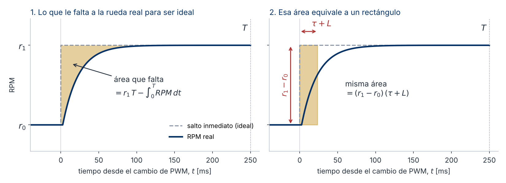
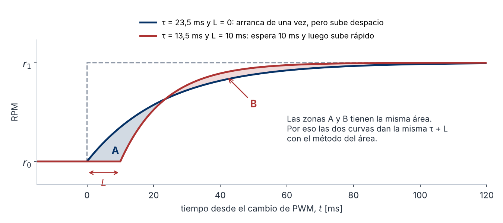
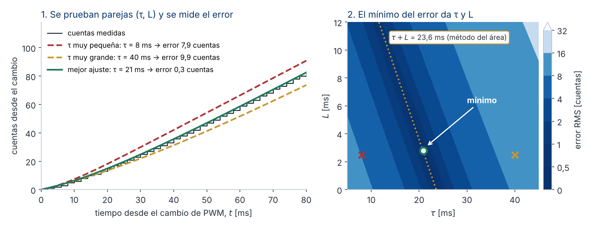

# Guía de laboratorio · Identificación del motor DC

**Control Inteligente II (168418) · Ingeniería Mecatrónica · Universidad de Pamplona**
**Ing. Jeisson Martínez Flórez · Semestre 2026-2**

---

## 1. Datos generales

| Campo | Valor |
|---|---|
| Actividad | Laboratorio 1 · Identificación del motor DC |
| Unidad | Modelado del balancín y diseño de los lazos de control |
| Sesión | 10A · miércoles 4 de noviembre de 2026 · 2 horas |
| Modalidad | Grupal (equipo del proyecto) |
| Herramientas | Firmware de este repositorio (PlatformIO o Arduino IDE) y el notebook `notebook/ajuste_motor.ipynb` (Python) |
| Entrega | Viernes 6 de noviembre de 2026, antes de la clase, en el repositorio del proyecto |

---

## 2. ¿Para qué nos sirve el modelo del motor?

En las clases anteriores sacamos el modelo del balancín con Euler-Lagrange y lo escribimos en espacio de estados. En ese modelo la entrada era el par τ de los motores. Resulta que ningún robot del curso manda par. Lo que manda el microcontrolador es un PWM. Entonces falta una pieza, que es saber cómo responde cada motor a ese PWM.

La estructura de control que vamos a usar en el proyecto es una cascada:

```
lazo de posición y velocidad  →  lazo de ángulo  →  lazo de RPM de cada rueda  →  PWM  →  motor
```

El lazo de adentro, el de RPM, hace que cada rueda gire a la velocidad que le piden, sin importar la carga ni cuánta batería quede. Es decir, convierte la rueda en una **fuente de velocidad**, y así el lazo de ángulo trabaja sobre una planta más limpia y con unidades físicas. Para diseñar ese lazo de RPM con números, y no por prueba y error, lo que necesitamos es el modelo del motor. Eso es lo que van a obtener en este laboratorio.

Es importante que tengan en cuenta que aquí se combinan las dos formas de modelar que hemos visto. La teoría (modelo de caja blanca) dice qué **forma** tiene el modelo, que en este caso es un primer orden con una zona muerta. El experimento dice cuánto valen sus **parámetros** en su robot, con su batería y su reductora.

---

## 3. Lo que van a obtener

Para cada una de las dos ruedas:

| Parámetro | Qué es | Unidades |
|---|---|---|
| K y B | Recta estática: RPM ≈ K·PWM − B | RPM/PWM y RPM |
| Zona muerta | PWM mínimo con el que la rueda gira de forma sostenida, hacia adelante y hacia atrás | PWM |
| τ | Constante de tiempo al acelerar o al cambiar de velocidad | ms |
| τ de freno | Constante de tiempo al llevar el PWM a 0 | ms |
| L | Retardo puro | ms |
| Cuentas por vuelta | Cuentas del encoder por cada vuelta de la rueda, medidas a mano | cuentas |

Todo queda en un archivo `parametros_motor_G<n>.json`, que es el que vamos a usar en las simulaciones de las próximas sesiones.

---

## 4. Fundamento

### 4.1 Del motor DC al primer orden

Un motor DC tiene una parte eléctrica y una parte mecánica:

$$L_a\frac{di}{dt} + R\,i = V - K_e\,\omega \qquad\qquad J\frac{d\omega}{dt} = K_t\,i - b\,\omega - \tau_{carga}$$

- V es el voltaje aplicado e i la corriente.
- R y L_a son la resistencia y la inductancia del devanado.
- K_e es la constante de fuerza contraelectromotriz y K_t la constante de par.
- J es la inercia (motor, reductora y rueda) y b la fricción viscosa.

En un motorreductor pequeño la corriente responde en menos de un milisegundo, mientras que la velocidad tarda decenas de milisegundos. Entonces, lo que uno hace es despreciar L_a. Con eso queda un sistema de primer orden:

$$\frac{\omega(s)}{V(s)} = \frac{K_m}{\tau_m s + 1}, \qquad K_m = \frac{K_t}{R\,b + K_t K_e}, \qquad \tau_m = \frac{R\,J}{R\,b + K_t K_e}$$

Es decir, la teoría nos dice que la RPM de la rueda debe responder a un cambio de voltaje como una curva exponencial, con una ganancia y una constante de tiempo. No hace falta conocer R, J ni K_t por separado, porque el controlador solo ve K_m y τ_m. Y esos dos números se pueden medir.

### 4.2 Del voltaje al PWM

El TB6612 entrega a cada motor un voltaje promedio proporcional al ciclo útil del PWM:

$$V \approx \frac{PWM}{255}\,V_{bat}$$

Esto tiene una consecuencia práctica. La ganancia que van a medir, en RPM por unidad de PWM, depende del voltaje de la batería en ese momento. Si la batería baja de 8,4 V a 7,4 V, K baja más o menos un 12 %. Por eso cada grupo mide la batería con el multímetro antes de los ensayos y la anota en el firmware con el comando `b`. Más adelante, el integrador del lazo de RPM es el que corrige esa diferencia mientras el robot funciona.

### 4.3 La zona muerta

Si el modelo fuera solo el de la sección 4.1, la recta RPM–PWM pasaría por el origen. Resulta que no pasa. Con PWM pequeños la rueda no gira, porque el par del motor no alcanza a vencer la fricción seca y el juego de la reductora. Por ejemplo, en el robot del docente la rueda derecha arranca con PWM 16 hacia adelante y con 20 hacia atrás.

Por eso la parte estática se modela como una recta desplazada, RPM ≈ K·PWM − B, válida solo por encima de la zona muerta. Además, arrancar desde parado cuesta más que mantener el giro. Por eso la zona muerta se mide subiendo el PWM por peldaños (escalera) y no con un solo escalón.

### 4.4 El encoder en cuadratura

El encoder entrega dos señales, A y B, desfasadas un cuarto de ciclo. El firmware cuenta los cuatro flancos de cada ciclo (decodificación x4) y con el orden en que cambian sabe el sentido de giro. Entonces, en teoría:

$$\text{cuentas por vuelta de rueda} = \text{pulsos por vuelta del motor} \times 4 \times \text{reducción}$$

En la práctica la reducción real no siempre coincide con la que dice el vendedor. Por ejemplo, en el robot del docente se midieron 2618 cuentas por vuelta, y no las que daba la hoja de datos. Por eso las cuentas por vuelta se miden a mano, girando la rueda un número exacto de vueltas.

Hay que tener en cuenta también la resolución. El contador del encoder solo tiene números enteros, así que la RPM calculada entre dos muestras va a saltos. En el escalón, el sketch toma una muestra cada 2 ms. Con 2618 cuentas por vuelta, una cuenta de diferencia en 2 ms equivale a 60 / (2618 · 0,002) = 11,5 RPM. Por ejemplo, una rueda que gira estable a 25 RPM avanza 2,2 cuentas cada 2 ms. Como el contador no tiene decimales, unas veces se leen 2 cuentas (22,9 RPM) y otras 3 (34,4 RPM). Ese salto lo produce el redondeo, no el motor. Una ventana más larga reduce el salto, pero también borra el arranque, que dura unos 20 ms.

Por eso el ajuste del modelo no usa la RPM, sino las **cuentas acumuladas**, es decir, el valor del contador, que va sumando mientras la rueda gira. El contador solo cambia cuando la rueda avanza una cuenta completa (1/2618 de vuelta, unos 0,14°). Si la rueda está a mitad de camino entre dos cuentas, el contador todavía muestra la anterior. Así, el contador nunca se equivoca en más de una cuenta frente a la posición real, y ese error no crece con el tiempo. Con la rueda a 25 RPM, en 250 ms (la ventana de ajuste del notebook) el contador sube unas 273 cuentas, y equivocarse en una es menos del 0,4 %. En cambio, entre dos muestras separadas 2 ms solo hay unas 2 cuentas, y equivocarse en una cambia la RPM en casi la mitad.

### 4.5 El freno en corto

Con el driver habilitado y PWM 0, el TB6612 pone en corto los terminales del motor. La fuerza contraelectromotriz genera entonces una corriente que frena el motor. Por eso, al llevar el PWM a 0, la rueda se detiene más rápido que cuando se cambia de un PWM a otro distinto de cero, y la τ de freno sale menor. Las dos se reportan por separado. La que importa para el lazo de RPM es la τ normal, porque el lazo casi siempre trabaja lejos de cero.

### 4.6 Cómo se mide τ

Después de un cambio de PWM de u₀ a u₁, la RPM pasa de r₀ a r₁ siguiendo el primer orden con retardo:

$$RPM(t) = r_0 + (r_1 - r_0)\left(1 - e^{-(t-L)/\tau}\right), \qquad t \ge L$$

donde:

- u₀ es el PWM antes del cambio y u₁ el PWM después del cambio.
- r₀ es la RPM estable antes del cambio. El firmware y el notebook la calculan como la RPM media de los últimos 60 ms antes del cambio.
- r₁ es la RPM estable a la que llega la rueda con u₁. Se calcula como la RPM media de la segunda mitad del escalón, cuando la rueda ya se estabilizó.
- t es el tiempo contado desde el instante del cambio de PWM.
- L es el retardo, es decir, el tiempo que pasa desde el cambio de PWM hasta que la RPM empieza a moverse. Antes de L, la RPM sigue en r₀.
- τ es la constante de tiempo. En t = L + τ la RPM ya recorrió el 63 % del camino entre r₀ y r₁.

Por ejemplo, con `s R 120 60` la rueda derecha está en PWM 60 y pasa a PWM 120, así que u₀ = 60 y u₁ = 120. Si a PWM 60 la rueda giraba a unas 13 RPM y con PWM 120 llega a unas 28 RPM, entonces r₀ ≈ 13 RPM y r₁ ≈ 28 RPM.

#### Método del área

El firmware da una primera estimación con el **método del área**. La idea es comparar dos áreas bajo la curva de la RPM, desde el cambio (t = 0) hasta un tiempo T. Si la rueda saltara de inmediato de r₀ a r₁, esa área sería r₁·T. La rueda real tarda en subir, así que su área es menor. El área que falta, dividida por el salto r₁ − r₀, es τ + L:

$$\tau + L = \frac{r_1\,T - \int_0^T RPM\,dt}{r_1 - r_0}$$



*Figura 1. Método del área con valores de ejemplo (r₀ = 13 RPM, r₁ = 28 RPM, τ = 21 ms, L = 2,5 ms). A la izquierda, el área sombreada es la diferencia entre el salto ideal y la RPM real. La parte que queda debajo de la curva real es común a las dos áreas y se cancela. A la derecha, esa misma área se dibuja como un rectángulo de alto r₁ − r₀ y ancho τ + L.*

T tiene que ser bastante más largo que τ + L, para que al final la RPM ya esté en r₁. El firmware y el notebook usan T = 250 ms, más de 10 veces τ.

La integral no se calcula a partir de la RPM. Sale directamente de las cuentas, con t en segundos:

$$\int_0^T RPM\,dt = 60 \cdot \frac{\text{cuentas giradas entre } 0 \text{ y } T}{\text{cuentas por vuelta}}$$

Por eso este método no tiene el problema de resolución de la sección 4.4.

#### El área no separa τ de L

El área solo da la suma τ + L. Dos respuestas con la misma suma tienen la misma área que falta, aunque arranquen distinto. La figura 2 lo muestra. Una curva arranca de una vez y sube despacio (τ = 23,5 ms, L = 0). La otra espera 10 ms y luego sube rápido (τ = 13,5 ms, L = 10 ms). La zona A, donde la primera va adelante, tiene la misma área que la zona B, donde va adelante la segunda. Las dos zonas se compensan, y el método del área da 23,5 ms para las dos curvas.



*Figura 2. Dos respuestas con la misma τ + L = 23,5 ms. El método del área no las distingue. Lo que cambia es la forma del arranque.*

Entonces hay dos caminos:

- **El firmware no separa τ de L.** Supone que L es casi cero y reporta τ + L como si fuera τ. Es una estimación rápida, que sirve para comparar ensayos en el banco. Como L suele valer entre 0 y 4 ms y τ unos 20 ms, esa τ sale un poco mayor que la real.
- **El notebook separa τ de L mirando la forma del arranque**, con mínimos cuadrados. Ese ajuste entrega τ y L por separado, y son los valores que se usan en el modelo.

Separar τ de L no es fácil, porque la diferencia de forma es pequeña. En la figura 2, aun con L = 10 ms, las cuentas de una curva y de la otra nunca se separan más de 2,4 cuentas.

#### Mínimos cuadrados

La idea es buscar la pareja (τ, L) con la que el modelo se parece más a lo que midió el encoder, en toda la curva y no solo en su área.

El modelo no se compara con la RPM, por el problema de resolución de la sección 4.4. Se compara con las cuentas. Para eso, la RPM del modelo se integra y se pasa a cuentas, contando desde el instante del cambio:

$$c_{mod}(t) = \frac{\text{cuentas por vuelta}}{60}\Big[r_0\,t + (r_1-r_0)\big((t-L) - \tau\,(1-e^{-(t-L)/\tau})\big)\Big], \qquad t \ge L$$

Antes de L la rueda sigue en r₀, así que ahí solo queda el término r₀·t.

Para cada pareja (τ, L) que se prueba, se calcula en cada muestra la diferencia entre las cuentas medidas y las del modelo. Esas diferencias se elevan al cuadrado y se suman:

$$J(\tau, L) = \sum_k \big(c_{med}(t_k) - c_{mod}(t_k)\big)^2$$

Se elevan al cuadrado para que una diferencia positiva y una negativa no se cancelen, y para que una diferencia grande pese más que varias pequeñas. La pareja con la J más pequeña es el resultado.

El notebook no prueba todas las parejas una por una. La función `least_squares` de SciPy arranca en τ = 20 ms y L = 2 ms, y va cambiando los dos valores en la dirección en que J baja, hasta que ya no baja más. r₀ y r₁ no se ajustan, porque ya se midieron. Al final, el notebook reporta el error RMS, que es la raíz del promedio de esos cuadrados, en cuentas. Un buen ajuste queda por debajo de una cuenta, que es la resolución del encoder.



*Figura 3. Mínimos cuadrados con datos sintéticos. Las cuentas medidas salen del modelo con τ = 21 ms y L = 2,5 ms, redondeadas a enteros como hace el contador. A la izquierda, tres parejas de prueba. Con τ muy pequeña el modelo cuenta de más, con τ muy grande cuenta de menos, y el mejor ajuste pasa por la escalera de las cuentas medidas. A la derecha, el error de cada pareja (τ, L). Entre más oscuro, menor es el error. El ajuste da τ = 20,9 ms y L = 2,8 ms, y la diferencia con los valores reales la produce el redondeo del contador.*

Fíjense en que el valle oscuro de la figura 3 es una franja diagonal que sigue la recta τ + L = constante. Eso quiere decir que las parejas con la misma suma τ + L dan errores pequeños y parecidos. En el ejemplo, todas las de la recta quedan por debajo de una cuenta, mientras que subir L unos 3 ms, dejando τ igual, lleva el error a 2 cuentas. La suma la fija el área, y lo que separa τ de L es la forma del arranque. Por eso el ajuste mide bien la suma τ + L, y L por sí sola es el valor menos confiable.

Los dos métodos deben dar parecido. Es decir, la τ + L del método del área debe parecerse a la suma de τ y L de mínimos cuadrados. Si no se parecen, hay algo que revisar en los datos.

---

## 5. Materiales

| Elemento | Detalle |
|---|---|
| Robot del grupo | Con la batería cargada |
| Soporte | El robot queda vertical o acostado, con **las dos ruedas en el aire** |
| Cable USB | Conectado al puerto UART/COM de la placa |
| Multímetro | Para medir la batería |
| Marcador o cinta | Para marcar una referencia en cada rueda |
| Computador | VS Code con PlatformIO (o Arduino IDE) y Python con Jupyter (VS Code o Google Colab) |

---

## 6. Procedimiento

En cada parte, la columna «Qué deben ver» dice cuándo pueden seguir. Si algo no coincide, miren la columna «Si sale mal» antes de pasar a la siguiente parte. Es importante que no salten pasos. Un signo mal puesto en la parte C, por ejemplo, daña todos los datos de las partes D y E.

### Parte A · Preparar el firmware (10 min)

| Paso | Qué hacer | Qué deben ver | Si sale mal |
|---|---|---|---|
| A1 | Descarguen este repositorio y ábranlo en VS Code (o sigan las instrucciones del README para el Arduino IDE) | La carpeta abre como proyecto de PlatformIO | — |
| A2 | En `src/config.h` escriban los pines de **su** PCB: PWM, IN1 e IN2 de cada motor, STBY y los canales A y B de cada encoder | — | Si STBY va fijo a 3,3 V, escriban `-1`. Si un canal B no existe o está dañado, también `-1` |
| A3 | Compilen, carguen y abran el monitor serie a 115200 | El mensaje de arranque con la versión y los pines | Si no carga, revisen si un encoder está en un pin de arranque (GPIO 0, 3, 45 o 46) y desconéctenlo mientras cargan |
| A4 | Escriban `h` y Enter | La lista de comandos | Si no pasa nada, el monitor no está enviando fin de línea |

### Parte B · Verificar los encoders (15 min)

Con el motor apagado, lo que hacemos es girar cada rueda a mano para comprobar que el encoder cuenta bien antes de confiar en él.

| Paso | Qué hacer | Qué deben ver | Si sale mal |
|---|---|---|---|
| B1 | `e` y giren despacio la rueda izquierda hacia adelante | A y B cambian alternados (00 → 01 → 11 → 10). Las cuentas suben. Los flancos de A y de B crecen parecido. Errores en 0 | Si las cuentas bajan, cambien `ENC_L_SIGNO`. Si solo cambia A o solo B, hay un cable o un canal dañado |
| B2 | Lo mismo con la rueda derecha. Enter para salir | Lo mismo que en B1 | Si se mueven las cuentas de la otra rueda, los pines de los encoders están cruzados en `config.h` |
| B3 | `z`, marquen una referencia en cada rueda y giren cada una **10 vueltas exactas** hacia adelante | — | — |
| B4 | `c 10` | Las cuentas por vuelta de cada rueda | Repitan B3 y B4 hasta que dos medidas seguidas difieran en menos de 1 % |
| B5 | Copien los valores a `CUENTAS_VUELTA_L` y `CUENTAS_VUELTA_R` y vuelvan a cargar el programa | El mensaje de arranque muestra las cuentas nuevas | — |

### Parte C · Sentido de motores y encoders (10 min)

Ahora el robot va en el soporte, con las ruedas en el aire. A partir de aquí, Enter detiene los motores en cualquier momento.

| Paso | Qué hacer | Qué deben ver | Si sale mal |
|---|---|---|---|
| C1 | `d`. Cada motor gira 0,8 s con PWM +60. **Miren hacia dónde gira cada rueda** | El firmware dice si las cuentas salieron positivas o negativas | Usen la tabla de abajo |
| C2 | Corrijan los signos, vuelvan a cargar y repitan `d` | Las dos ruedas giran hacia adelante y cuentan positivo | — |

El firmware no sabe hacia dónde giró físicamente la rueda. Eso lo tienen que mirar ustedes:

| Cuentas | La rueda giró hacia adelante | La rueda giró hacia atrás |
|---|---|---|
| Positivas | Todo bien | Cambien `MOTOR_x_SIGNO` y `ENC_x_SIGNO` |
| Negativas | Cambien `ENC_x_SIGNO` | Cambien `MOTOR_x_SIGNO` |

### Parte D · Recta estática y zona muerta (15 min)

| Paso | Qué hacer | Qué deben ver |
|---|---|---|
| D1 | Midan la batería con el multímetro y anótenla: `b 7.9` (con su valor) | `Batería: 7.90 V` |
| D2 | `x L 10 5 14` (rueda izquierda, hacia adelante, de 10 a 75 en pasos de 5) | La tabla por peldaño, la recta K y B, y el PWM de arranque |
| D3 | `x L -10 -5 14` (hacia atrás) | Lo mismo, hacia atrás |
| D4 | `x R 10 5 14` y `x R -10 -5 14` | Lo mismo para la rueda derecha |

Después de cada ensayo, guarden el bloque entre `INICIO_CSV` y `FIN_CSV` como `G<n>_<motor>_escalera_<sentido>.csv`, por ejemplo `G3_R_escalera_adelante.csv`. Otra opción es activar `log2file` en el monitor y guardar toda la sesión en un solo archivo, como se explica en el README.

Como referencia, la recta debería quedar con un error menor que 1 RPM y la zona muerta entre 10 y 35 de PWM. Si la rueda no arranca en ningún peldaño, repitan la escalera empezando más arriba, por ejemplo `x R 30 5 14`.

### Parte E · Dinámica con escalones (25 min)

Cada escalón dura 2,5 s (300 ms en la base, 1500 ms en el escalón y 700 ms de regreso a la base) y se muestrea cada 2 ms.

| Paso | Comando | Para qué |
|---|---|---|
| E1 | `s R 60`, `s R 120`, `s R 200` | Arranque desde parado con tres amplitudes. Muestra cómo influye la zona muerta |
| E2 | `s R 120 60` | Cambio con la rueda ya girando. Este es el caso que más se parece al trabajo del lazo de RPM |
| E3 | `s R -120` y `s R -120 -60` | Lo mismo hacia atrás |
| E4 | Los mismos seis con `L` | Rueda izquierda |

Guarden cada bloque como `G<n>_<motor>_escalon_<base>_<pwm>.csv`, por ejemplo `G3_R_escalon_60_120.csv`.

En cada escalón el firmware imprime una estimación rápida de K y de τ. Esa τ es en realidad τ + L, porque sale del método del área (sección 4.6). Comparen entre ensayos. Las τ al acelerar deben ser parecidas entre sí, y la τ al volver a PWM 0 debe salir menor por el freno en corto.

### Parte F · Ajuste del modelo (30 min, y se termina fuera de clase)

| Paso | Qué hacer |
|---|---|
| F1 | Creen la carpeta `datos/G<n>/` y pongan ahí todos sus CSV (o el log completo) |
| F2 | Abran `notebook/ajuste_motor.ipynb`. En la celda 0 cambien `GRUPO = "G<n>"` y `RUTA_DATOS = Path("../datos/G<n>")` |
| F3 | Ejecuten todas las celdas. Primero pueden probar con los datos de ejemplo que trae el repositorio, que son sintéticos |
| F4 | Revisen la lista «Antes de entregar» al final del notebook |
| F5 | Copien `resultados/parametros_motor_G<n>.json` a su entrega |

---

## 7. Preguntas de análisis

Respóndanlas con sus datos, con números y en frases cortas.

1. En un escalón desde parado (0 → 120), la K incremental sale menor que en un escalón con la rueda girando (60 → 120). ¿Por qué? ¿Cuál de las dos describe mejor el motor para el lazo de RPM?
2. ¿Por qué la τ al llevar el PWM a 0 sale menor que al acelerar? ¿Qué pasaría si en lugar de PWM 0 se pusiera el driver en *standby* (STBY en bajo)?
3. Comparen la zona muerta hacia adelante y hacia atrás, y la de las dos ruedas. Cuando el balancín está casi quieto, las ruedas cambian de sentido todo el tiempo. ¿Qué efecto tiene la zona muerta en ese caso?
4. Con su τ y la resolución de su encoder, ¿qué limita más la rapidez del lazo de RPM, el motor o la medición de la RPM? Calculen cuántas RPM vale una cuenta en una ventana de 10 ms.
5. Si la batería baja de 8,4 V a 7,4 V, ¿cuánto cambia K según la sección 4.2? ¿Qué parte del lazo de RPM tiene que corregir eso?
6. Con la RPM máxima de su motor (PWM 255), calculen la velocidad máxima del robot en m/s. El lazo de equilibrio necesita reserva de velocidad para recuperarse cuando el robot se inclina. ¿Qué velocidad de avance les parece razonable para la pista, y por qué?

### Tarea propuesta · Otros métodos de identificación

El notebook calcula τ y L con mínimos cuadrados, pero hay otros métodos. Prueben dos métodos clásicos con uno de sus escalones con la rueda ya girando (por ejemplo, `s R 120 60`) y compárenlos con el notebook. Usen la gráfica de RPM de la sección 4 del notebook. Con la variable `ver` escogen la transición.

1. **Método de Smith (dos puntos).** Busquen el instante t₁ en que la RPM llega a r₀ + 0,283·(r₁ − r₀) y el instante t₂ en que llega a r₀ + 0,632·(r₁ − r₀). Luego calculen τ = 1,5·(t₂ − t₁) y L = t₂ − τ.
2. **Método de Ziegler y Nichols (tangente).** Tracen la recta tangente a la curva de RPM en el punto donde sube más rápido. Esa recta corta a r₀ en t = L y a r₁ en t = L + τ.
3. Hagan una tabla con τ y L de los tres métodos y respondan:
   - ¿Cuál de los dos métodos clásicos se acerca más al notebook?
   - ¿Por qué los métodos que leen la curva de RPM dan valores distintos? Piensen en la resolución de la sección 4.4.
   - ¿Cuál usarían para su robot, y por qué?

Pongan la tabla y las respuestas en `RESULTADOS.md`.

---

## 8. Requisitos de la entrega

En el repositorio del proyecto, rama `main`, carpeta `identificacion_motor/`:

| Archivo | Contenido |
|---|---|
| `datos/` | Todos los CSV o el log de la sesión |
| `config.h` | La versión final, con sus pines, signos y cuentas por vuelta |
| `ajuste_motor.ipynb` | El notebook ejecutado con sus datos |
| `parametros_motor_G<n>.json` | El archivo que genera el notebook |
| `RESULTADOS.md` | La tabla resumen de cada rueda, las respuestas a la sección 7 y una foto del robot en el soporte |

---

## 9. Criterios de éxito

La entrega está completa cuando se cumple todo esto:

- [ ] La batería quedó anotada en todos los ensayos (`bateria_V` distinto de 0).
- [ ] Las cuentas por vuelta se midieron a mano, y dos medidas seguidas difieren en menos de 1 %.
- [ ] Las dos ruedas avanzan con PWM positivo y cuentan positivo al avanzar.
- [ ] Los errores del encoder son 0 o casi 0 en todos los ensayos.
- [ ] Hay escaleras en los dos sentidos y los seis escalones en cada rueda.
- [ ] La recta estática tiene error RMS menor que 1 RPM.
- [ ] La τ por mínimos cuadrados y la τ + L por el método del área difieren en pocos milisegundos.
- [ ] La K incremental con la rueda girando no se aleja más de 5 % de la K de la recta.
- [ ] La validación del notebook sigue a la medida en todos los peldaños, salvo cerca de la zona muerta.
- [ ] Las seis preguntas tienen respuesta con números de su robot.

---

## 10. Errores frecuentes

| Síntoma | Causa probable | Qué hacer |
|---|---|---|
| Las RPM salen la cuarta parte o el doble de lo esperado | Las cuentas por vuelta no son las reales | Repitan la parte B |
| La recta sale con pendiente negativa | Un signo de motor o de encoder quedó mal | Repitan la parte C |
| τ sale de 100 ms o más | Se ajustó un escalón que no salió de la zona muerta, o el robot no estaba en el aire | Revisen que r₁ sea varias veces mayor que la zona muerta y que las ruedas giren libres |
| Muchos errores en el encoder | Cable flojo, ruido del motor o un canal dañado | Revisen conectores. Si un canal está dañado, configúrenlo con `-1` |
| K muy distinta entre dos sesiones | La batería tenía otro voltaje | Comparen el `bateria_V` de los CSV |
| El notebook no encuentra ensayos | La carpeta de `RUTA_DATOS` no es la correcta, o los archivos no tienen la línea `# ensayo=` | Revisen la ruta y copien el bloque completo, desde la línea `#` |

---

## 11. Recursos de apoyo

- `README.md` de este repositorio: comandos del firmware, estructura y problemas comunes.
- `notebook/ajuste_motor.ipynb`: ajuste del modelo, validación y punto de partida del lazo de RPM.
- Guía del modelado del balancín (Tema 1) y videos de los pasos 12 a 16.
- Valores medidos en el robot del docente, como referencia (rueda derecha, batería a 7,65 V): K = 0,25 RPM/PWM, B = 1,8 RPM, zona muerta 16 adelante y 20 atrás, τ ≈ 20 ms, τ de freno 10–15 ms, retardo de 0 a 4 ms, 2618 cuentas por vuelta.
- K. Ogata, *Ingeniería de control moderna*, 5.ª ed., Pearson, 2010. Modelo del motor DC.
- J. G. Ziegler y N. B. Nichols, «Optimum settings for automatic controllers», *Transactions of the ASME*, vol. 64, pp. 759–768, 1942. Método de la tangente (curva de reacción).
- C. L. Smith, *Digital Computer Process Control*, Intext, 1972. Método de los dos puntos (28,3 % y 63,2 %).
- K. J. Åström y T. Hägglund, *Advanced PID Control*, ISA, 2006. Método de las áreas e identificación de modelos de primer orden con retardo.
- Toshiba, *TB6612FNG Datasheet*. Tabla de verdad del driver: sentido, freno en corto y *standby*.
