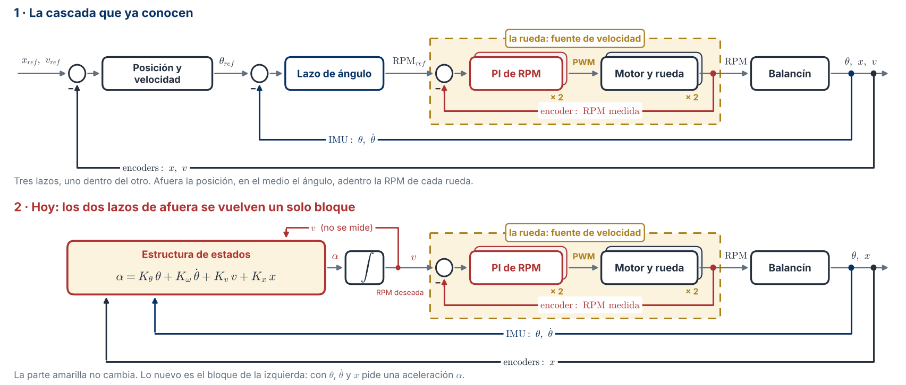
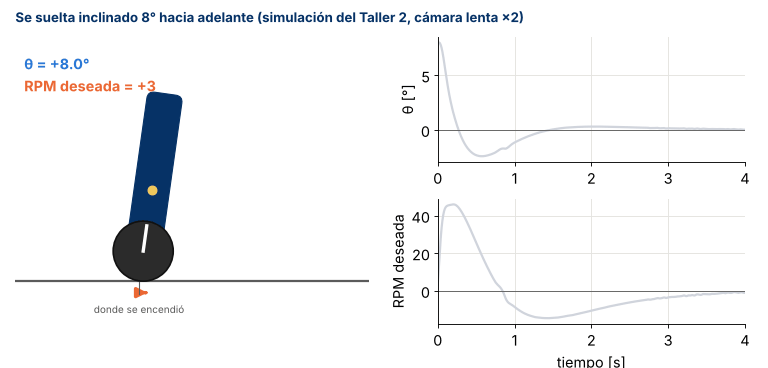
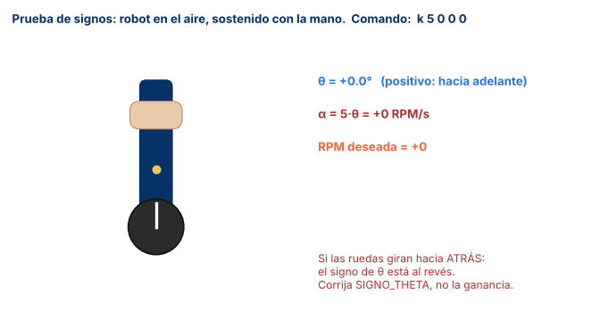
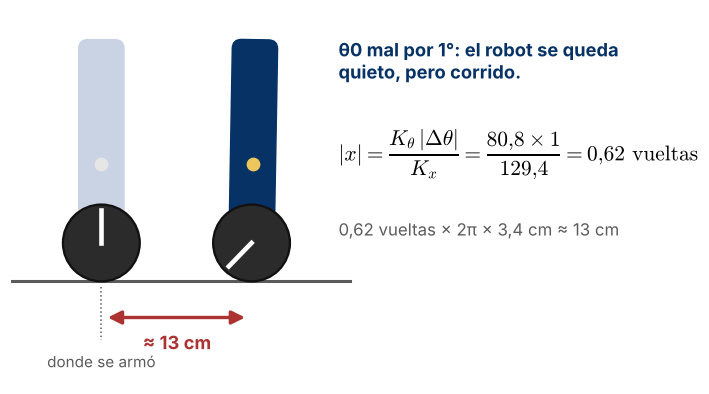

# Guía de laboratorio · Equilibrio con la estructura de estados

**Control Inteligente II (168418) · Ingeniería Mecatrónica · Universidad de Pamplona**\
**Ing. Jeisson Martínez Flórez · Semestre 2026-2**

---

## 1. Datos generales

| Campo | Valor |
|---|---|
| Actividad | Laboratorio · Primer equilibrio con las ganancias del modelo |
| Sesión | 11A · miércoles 11 de noviembre de 2026 · 8:00 a 10:00 |
| Modalidad | Grupal (equipo del proyecto) |
| Entran con | Las cuatro ganancias del Taller 2 y los dos lazos de RPM probados en el soporte |
| Archivos | `estructura_estados/` de este repositorio y el firmware de su grupo |
| Entrega | En el repositorio del proyecto, antes del Lab 2 (miércoles 18 de noviembre) |

---

## 2. Qué vamos a hacer hoy

Hasta ahora el robot equilibra con la cascada del Corte 1. Hoy cambiamos los dos lazos de afuera por un solo bloque, con las ganancias que sacaron del modelo en el Taller 2. El lazo de RPM de cada rueda, que es la parte amarilla del esquema, se queda igual.

---

## 3. La idea, paso a paso

### 3.1 El robot mide cuatro cosas

| Símbolo | Qué es | De dónde sale | Unidad |
|---|---|---|---|
| $\theta$ | Inclinación del robot | IMU (filtro complementario) | ° |
| $\dot\theta$ | Qué tan rápido se inclina | Giroscopio, directo, sin derivar | °/s |
| $v$ | Velocidad de las ruedas | Es la RPM deseada. No se mide, la calcula el mismo lazo | RPM |
| $x$ | Cuánto se ha movido el robot | Encoders: promedio de las dos ruedas | vueltas |

Los signos son los mismos para todos. Inclinado hacia adelante es $\theta > 0$. Ruedas hacia adelante es RPM $> 0$. Robot adelante de donde arrancó es $x > 0$.

### 3.2 Con esas cuatro cosas pide una aceleración

$$
\alpha = K_\theta\,\theta + K_\omega\,\dot\theta + K_v\,v + K_x\,x
$$

$\alpha$ es la aceleración que se le pide a las ruedas, en RPM/s. Cada término se lee así, con los números del ejemplo:

| Término | Ganancia | Se lee |
|---|---|---|
| $K_\theta\,\theta$ | 80,8 RPM/s por grado | Si el robot se inclina 1°, las ruedas aceleran 80,8 RPM/s **hacia el lado de la caída** |
| $K_\omega\,\dot\theta$ | 10,9 RPM/s por °/s | Si además se está cayendo rápido, acelera más |
| $K_v\,v$ | 3,21 1/s | Si ya va rodando hacia adelante, pide un poco más hacia adelante |
| $K_x\,x$ | 129,4 RPM/s por vuelta | Si ya se adelantó, pide un poco más hacia adelante |

Las dos últimas parecen al revés. Para frenar, el robot primero tiene que inclinarse hacia atrás, y para eso las ruedas tienen que adelantarse un poco al cuerpo. Por eso **las cuatro ganancias son positivas**.

Las de ustedes están en la tabla «En las unidades del firmware» del Taller 2 (sección B.3).

### 3.3 La aceleración se vuelve RPM deseada

Cada 5 ms se suma lo que se pidió:

$$
v \leftarrow v + \alpha\,T_s, \qquad T_s = 0{,}005\ \mathrm{s}
$$

Esa $v$ es la RPM deseada, y va a las dos ruedas. Tiene un tope (por ejemplo, ±50 RPM) para dejar margen bajo la RPM máxima del motor.

Así se ve en la simulación del Taller 2. El robot se suelta inclinado 8° hacia adelante:

Fíjense en tres cosas:
1. Las ruedas arrancan hacia adelante, hacia el lado de la caída.
2. El robot pasa un poco al otro lado (unos −2°) y vuelve.
3. Al final regresa a donde se armó. Eso lo hace $K_x$.

---

## 4. Un ciclo de 5 ms

En el firmware, cada 5 ms y siempre en este orden:

1. IMU → $\theta$ y $\dot\theta$.
2. Encoders → vueltas y RPM medida de cada rueda.
3. Lazo de equilibrio → $\alpha$ y la RPM deseada $v$.
4. Lazo de RPM de cada rueda → PWM.
5. Se guarda una copia para la telemetría.

Imprimir por el puerto serie se hace **fuera** de ese ciclo. Si se imprime adentro, el ciclo se demora y el control pierde el paso.

El esqueleto `estructura_estados/esqueleto_equilibrio.cpp` ya trae ese orden. Ustedes completan las partes marcadas con `TODO` usando el código que ya tienen para su IMU, sus encoders y sus motores.

| Archivo | Qué trae | ¿Lo modifican? |
|---|---|---|
| `lazo_config.h` | El modelo de sus motores. Lo generó el notebook del Taller 2 | No |
| `estructura_estados/lazo_rpm_nucleo.h` | El lazo de RPM de una rueda, igual al del Taller 2 | No |
| `estructura_estados/estructura_estados.h` | El lazo de equilibrio: la ecuación de 3.2, el tope y la seguridad | No |
| `estructura_estados/esqueleto_equilibrio.cpp` | El ciclo de 5 ms, los comandos y la telemetría | Sí: los `TODO` y las ganancias |

---

## 5. Procedimiento

**Importante.** Si algo gira al revés, se corrige el **signo de la medida** (`SIGNO_THETA`, `SIGNO_OMEGA` o los signos del Lab 1). Las ganancias nunca se cambian de signo.

### Parte 0 · Solo si el viernes no terminaron el lazo de RPM (25 min)

Hagan los pasos B1, B2 y B4 de `GUIA_LAZO_RPM.md`. Sin el lazo de RPM probado, la parte C no va a funcionar.

### Parte A · Los dos lazos de RPM en su firmware (20 min)

Robot en el soporte, ruedas en el aire.

| Paso | Qué hacer | Qué deben ver |
|---|---|---|
| A1 | Copien a su proyecto `lazo_config.h`, `lazo_rpm_nucleo.h`, `estructura_estados.h` y el esqueleto | — |
| A2 | Completen los `TODO`: leer la IMU, leer las vueltas de cada rueda y aplicar el PWM | — |
| A3 | Carguen y escriban `r 20` | Las dos ruedas a 20 RPM: columnas `yL` y `yR` cerca de 20 |
| A4 | `r -20` y luego `p` | Las dos hacia atrás. Con `p` se detienen |
| A5 | Miren la columna `ciclo_us` | Siempre menos de 2000 µs. El ciclo dura 5000 µs y necesita margen |

### Parte B · Signos y ángulo de equilibrio (15 min)

Robot en la mano.

| Paso | Qué hacer | Qué deben ver | Si no |
|---|---|---|---|
| B1 | Inclínenlo hacia adelante | `theta` positivo | `SIGNO_THETA = -1` |
| B2 | Inclínenlo hacia adelante, moviéndolo | `omega` positivo mientras se mueve | `SIGNO_OMEGA = -1` |
| B3 | Con `p`, rueden el robot hacia adelante sobre la mesa | `x` crece | Revisen los signos de los encoders del Lab 1 |
| B4 | Busquen con la mano el punto donde el robot «no se quiere caer» y lean `theta` unos segundos | Un valor estable, por ejemplo 1,5° | — |
| B5 | Escriban ese valor con `o`, por ejemplo `o 1.5` | Desde ahí, en ese punto `theta` da 0 | — |

**Prueba en el aire (B6).** Escriban `k 5 0 0 0` (solo un $K_\theta$ pequeño) y luego `e`. Sostengan el robot vertical y después inclínenlo hacia adelante:

- Las ruedas deben girar **hacia adelante** y acelerar mientras esté inclinado.
- Al volver a la vertical siguen girando. Es normal, porque la RPM deseada es una integral. Paren con `p`.
- Repitan hacia atrás. Deben girar hacia atrás.

### Parte C · Primer equilibrio (30 min)

Robot en el piso. Una persona con las manos cerca, **sin tocarlo**. Cambien las ganancias siempre con `p` primero.

| Paso | Qué hacer | Qué deben ver |
|---|---|---|
| C1 | `k Kθ Kω Kv 0` (las suyas, con $K_x = 0$) y `e` con el robot vertical | Se sostiene solo y se va corriendo despacio |
| C2 | `p`, `k Kθ Kω Kv Kx` (las cuatro) y `e` | Se sostiene y se queda cerca de donde se armó |
| C3 | 30 s sin tocarlo. Guarden el registro (`log2file`) | `theta` cerca de 0 y `x` cerca de 0 |
| C4 | Dos empujoncitos suaves con un dedo, con 5 s entre ellos. Guarden el registro | Se recupera y vuelve a su sitio |

Si el robot se queda quieto pero inclinado y corrido, el problema es $\theta_0$:

En reposo el robot no se mueve ($v = 0$, $\dot\theta = 0$, $\alpha = 0$). Entonces la ecuación de 3.2 queda $K_\theta\,\Delta\theta + K_x\,x = 0$, y el robot se corre

$$
|x| = \frac{K_\theta\,|\Delta\theta|}{K_x}
$$

Con las ganancias del ejemplo, 1° de error son unos 13 cm. Lean la inclinación media de C3, súmenla a $\theta_0$ y repitan.

### Parte D · Guardar (5 min)

Copien los registros de C3 y C4 a `datos/` y anoten las ganancias y el $\theta_0$ que usaron.

---

## 6. Si algo sale mal

| Lo que ven | Lo más probable | Qué hacer |
|---|---|---|
| Las ruedas empujan hacia el lado contrario de la caída | El signo de $\theta$ | Repitan B1 y B6 |
| Vibra rápido o zumba | Ruido en $\dot\theta$ o mucho retardo en la IMU | Bajen el filtro de la IMU o escojan polos más lentos en el Taller 2 (sección B.5) |
| Se mece despacio, cada vez más | $\theta_0$ mal puesto o $K_x$ grande para su $K_\theta$ | Corrijan $\theta_0$. Si sigue, polos más lentos |
| Se sostiene, pero se va hasta caerse, con la RPM deseada en el tope | Falta $K_x$ o el signo de $x$ está mal | Repitan B3 y C2 |
| Gira sobre su eje | Una rueda no sigue bien su RPM | Repitan A3 con esa rueda. El rumbo se corrige el 20 de noviembre |
| `ciclo_us` alto o irregular | Impresiones o esperas dentro del ciclo, o I2C lento | Saquen los `Serial.print` del ciclo. Pongan el I2C a 400 kHz |
| Se cae con un empujón fuerte, con la RPM deseada en el tope | El motor llegó a su límite | Es normal. Empujen más suave |

---

## 7. Criterios de éxito

- [ ] Las dos ruedas siguen `r 20` y `r -20` en el soporte.
- [ ] `ciclo_us` menor que 2000 µs.
- [ ] En el aire, las ruedas aceleran hacia el lado de la inclinación.
- [ ] El robot se sostiene 30 s solo, con las cuatro ganancias del modelo.
- [ ] Después de un empujoncito vuelve a menos de 5 cm de donde se armó.
- [ ] Los registros de C3 y C4 están guardados con las ganancias y el $\theta_0$ que se usaron.

---

## 8. Entrega (antes del Lab 2, miércoles 18 de noviembre)

En el repositorio del proyecto, carpeta `equilibrio/`:

| Archivo | Contenido |
|---|---|
| El firmware | Con la estructura de estados funcionando |
| `datos/` | Los registros de C3 y C4 |
| `RESULTADOS.md` | Las ganancias (unidades del firmware), $\theta_0$ y las respuestas a las tres preguntas |

Preguntas, con los números de su robot:

1. En C3, ¿cuánto se corrió el robot y qué inclinación media tuvo? ¿Cuadra con la fórmula de $\theta_0$?
2. En C4, ¿a cuánto llegó la RPM deseada? Compárenlo con la simulación del Taller 2 (sección B.4).
3. ¿Tuvieron que cambiar alguna ganancia? ¿Cuál, cuánto y por qué?

Guarden también el firmware de la cascada del Corte 1. En el Lab 2 se comparan los dos con datos.

---

## 9. Recursos

- `notebook/taller2_diseno.ipynb`, sección B: la planta con $\alpha$, las ganancias y la simulación.
- `GUIA_LAZO_RPM.md`: el lazo de RPM de cada rueda.
- Guía de modelado del balancín: las constantes A, B y C.
- `estructura_estados/`: el esqueleto y los dos archivos de cabecera.
