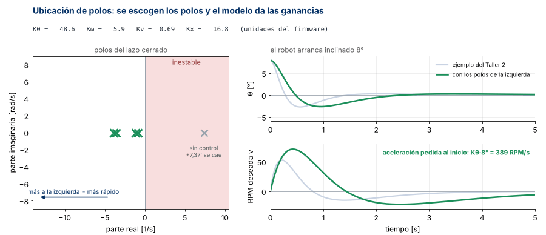
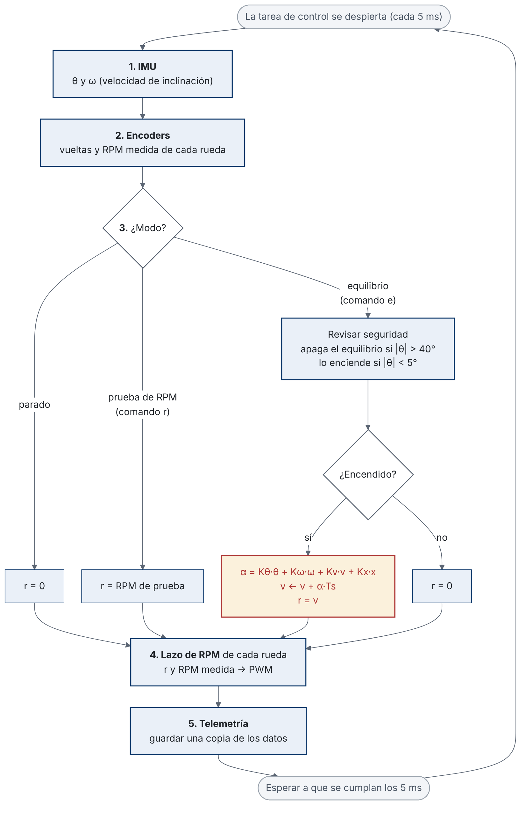
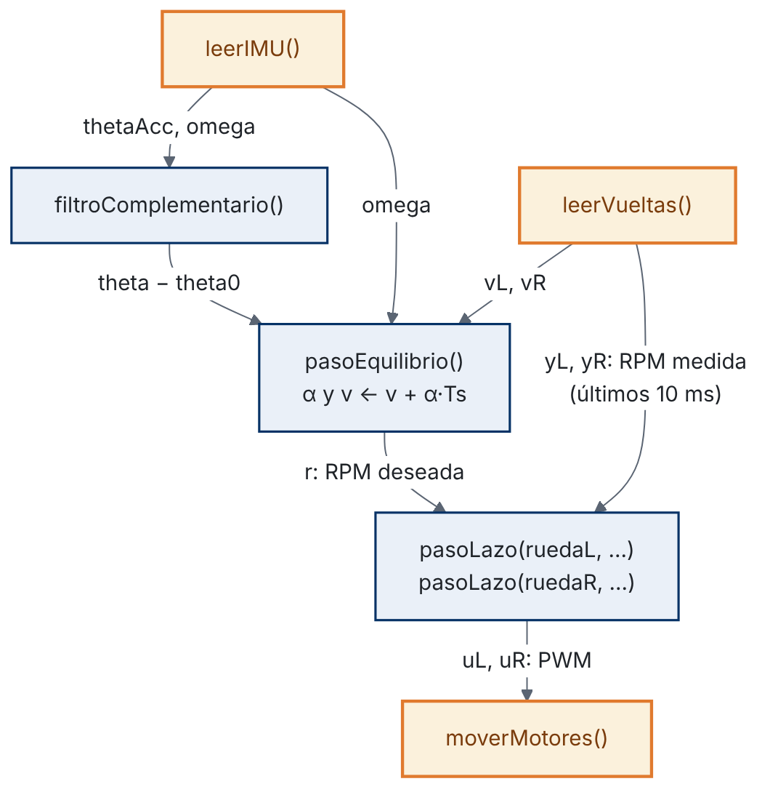

# Guía de laboratorio · Equilibrio con la estructura de estados

**Control Inteligente II (168418) · Ingeniería Mecatrónica · Universidad de Pamplona**\
**Ing. Jeisson Martínez Flórez · Semestre 2026-2**

---

## 1. Datos generales

| Campo | Valor |
|---|---|
| Actividad | Laboratorio · Primer equilibrio con las ganancias del modelo |
| Sesión | 11A · miércoles 11 de noviembre de 2026 · 8:00 a 10:00 |
| Modalidad | Grupal (equipo del proyecto) |
| Entran con | Las cuatro ganancias del Taller 2 y los dos lazos de RPM probados en el soporte |
| Archivos | `estructura_estados/` de este repositorio y el firmware de su grupo |
| Entrega | En el repositorio del proyecto, antes del Lab 2 (miércoles 18 de noviembre) |

---

## 2. Qué vamos a hacer hoy

Hasta ahora el robot equilibra con la cascada del Corte 1. Hoy cambiamos los dos lazos de afuera por un solo bloque, con las ganancias que sacaron del modelo en el Taller 2. El lazo de RPM de cada rueda, que es la parte amarilla del esquema, se queda igual.


### 2.1 ¿Qué control es este y por qué cambiamos la cascada?

Es una **realimentación de estados**. El controlador mira a la vez los cuatro estados del robot ($\theta$, $\dot\theta$, $v$ y $x$) y con una sola ecuación decide la aceleración de las ruedas. Las cuatro ganancias salen por **ubicación de polos**, que es lo que hicieron en el Taller 2.

**¿En qué consiste la ubicación de polos?** Los polos del lazo cerrado son las raíces de su polinomio característico, y dicen cómo responde el robot. Cada polo real $s = -p$ aporta a la respuesta un término $e^{-pt}$, que casi desaparece en unos $4/p$ segundos. Un par de polos con parte imaginaria hace que la respuesta oscile. Con la realimentación de estados, el polinomio característico del robot depende de las cuatro ganancias ($a$ y $b$ son del modelo y las $k$ están en unidades SI):

$$
s^4 + (b\,k_\omega - k_v)\,s^3 + (b\,k_\theta - a - k_x)\,s^2 + a\,k_v\,s + a\,k_x
$$

El procedimiento tiene tres pasos:

1. Escoger dónde se quieren los cuatro polos. En el ejemplo: $-6$, $-6{,}5$, $-1{,}5$ y $-2$.
2. Multiplicar $(s+6)(s+6{,}5)(s+1{,}5)(s+2)$ para obtener el polinomio deseado.
3. Igualar los coeficientes de los dos polinomios y despejar las cuatro ganancias.

La animación muestra qué pasa al mover los polos, con el robot arrancando inclinado 8°:



- Sin control, el modelo tiene un polo en $+7{,}37$. Está a la derecha del eje, y por eso el robot se cae solo.
- Polos más a la izquierda: el robot vuelve más rápido, pero las ganancias crecen y piden más aceleración al inicio. Con ganancias grandes, el ruido de la IMU y el retardo afectan más.
- Polos más cerca del eje: ganancias pequeñas, pero el robot tarda más en volver y rueda más.
- Polos con parte imaginaria: la respuesta oscila.

| | Cascada del Corte 1 | Estructura de estados |
|---|---|---|
| Cuántos controladores | Tres lazos, uno dentro del otro | Un bloque con cuatro ganancias, más el lazo de RPM |
| De dónde salen las ganancias | Prueba y error, lazo por lazo | Del modelo, las cuatro a la vez |
| Si se mueve una ganancia | Cambia el comportamiento de los otros lazos | Se sabe dónde quedan los polos |
| Qué se sabe antes de probar | Casi nada | Si es estable, el $K_\theta$ mínimo y el efecto del retardo, en la simulación |
| Qué sale del lazo de ángulo | PWM directo: la batería y la zona muerta lo cambian todo | Una aceleración en RPM/s. El lazo de RPM se encarga de la batería y la zona muerta |

La cascada no está mal. Usa las mismas cuatro señales. La diferencia es cómo se escogen las ganancias. Además, esta estructura es la que usa el LQR (20 de noviembre) y la que la red neuronal va a imitar en el Corte 3. En el Lab 2 se comparan las dos con datos.

---

## 3. La idea, paso a paso

### 3.1 El robot mide cuatro cosas

| Símbolo | Qué es | De dónde sale | Unidad |
|---|---|---|---|
| $\theta$ | Inclinación del robot | IMU (filtro complementario) | ° |
| $\dot\theta$ | Qué tan rápido se inclina | Giroscopio, directo, sin derivar | °/s |
| $v$ | Velocidad de las ruedas | Es la RPM deseada. No se mide, la calcula el mismo lazo | RPM |
| $x$ | Cuánto se ha movido el robot | Encoders: promedio de las dos ruedas | vueltas |

Los signos son los mismos para todos. Inclinado hacia adelante es $\theta > 0$. Ruedas hacia adelante es RPM $> 0$. Robot adelante de donde arrancó es $x > 0$.

### 3.2 Con esas cuatro cosas pide una aceleración

$$
\alpha = K_\theta\,\theta + K_\omega\,\dot\theta + K_v\,v + K_x\,x
$$

$\alpha$ es la aceleración que se le pide a las ruedas, en RPM/s. Cada término se lee así, con los números del ejemplo:

| Término | Ganancia | Se lee |
|---|---|---|
| $K_\theta\,\theta$ | 80,8 RPM/s por grado | Si el robot se inclina 1°, las ruedas aceleran 80,8 RPM/s **hacia el lado de la caída** |
| $K_\omega\,\dot\theta$ | 10,9 RPM/s por °/s | Si además se está cayendo rápido, acelera más |
| $K_v\,v$ | 3,21 1/s | Si ya va rodando hacia adelante, pide un poco más hacia adelante |
| $K_x\,x$ | 129,4 RPM/s por vuelta | Si ya se adelantó, pide un poco más hacia adelante |

Las dos últimas parecen al revés. Si el robot va hacia adelante, uno esperaría que el control frenara las ruedas. Pero el robot no puede frenar directamente: si las ruedas frenan, el cuerpo sigue hacia adelante y se cae. Para frenar, primero tiene que inclinarse hacia atrás, y para eso las ruedas aceleran un momento hacia adelante, por debajo del cuerpo. Después, el término $K_\theta\,\theta$ frena las ruedas. Es lo mismo que hace la mano con una escoba parada en la palma: para llevar la escoba hacia atrás, la mano primero se mueve hacia adelante.

El modelo dice lo mismo. Para que un polinomio característico sea estable, todos sus coeficientes tienen que ser positivos (condición necesaria de Routh-Hurwitz). En el polinomio de la sección 2.1, los dos últimos coeficientes son $a\,k_v$ y $a\,k_x$. Como $a > 0$, $K_v$ y $K_x$ tienen que ser positivas. Por eso **las cuatro ganancias son positivas**, y si a una se le cambia el signo, el robot se cae.

Las de ustedes están en la tabla «En las unidades del firmware» del Taller 2 (sección B.3).

### 3.3 La aceleración se vuelve RPM deseada

La ecuación de 3.2 da una aceleración, pero el lazo de RPM de cada rueda necesita una velocidad: la RPM deseada. La velocidad es la integral de la aceleración, $v = \int \alpha\,dt$. Es el bloque $\int$ del esquema de la sección 2, entre la estructura de estados y la RPM deseada.

En el microcontrolador, esa integral se calcula sumando en cada ciclo la aceleración pedida por la duración del ciclo:

$$
v_k = v_{k-1} + \alpha_k\,T_s, \qquad T_s = 0{,}005\ \mathrm{s}
$$

Se lee: la RPM deseada nueva es la anterior más lo que cambió en estos 5 ms. Por ejemplo, con $\alpha = 400$ RPM/s, en un ciclo la RPM deseada sube $400 \times 0{,}005 = 2$ RPM. En el resto de la guía también aparece como $v \leftarrow v + \alpha\,T_s$, donde la flecha significa «reemplazar».

Esta ecuación es parte del controlador, junto con la de 3.2. Se necesita porque en el Taller 2 el modelo usa la aceleración de las ruedas como entrada, y el lazo de RPM recibe una velocidad. Esta misma $v$ es el tercer estado de la ecuación de 3.2.

Esa $v$ va a las dos ruedas. Tiene un tope (por ejemplo, ±50 RPM) para dejar margen bajo la RPM máxima del motor.

Así se ve en la simulación del Taller 2. El robot se suelta inclinado 8° hacia adelante:


Fíjense en tres cosas:
1. Las ruedas arrancan hacia adelante, hacia el lado de la caída.
2. El robot pasa un poco al otro lado (unos −2°) y vuelve.
3. Al final regresa al punto donde se encendió el equilibrio. Eso lo hace $K_x$.

---

## 4. Firmware

### 4.1 ¿Por qué cada 5 ms?

En el paso 16 de la guía de modelado sacamos el periodo de muestreo con la regla de 20 muestras dentro de la constante de tiempo del polo inestable:

$$
T_s \le \frac{1}{20}\cdot\frac{1}{p}
$$

Con el par como entrada, $p = 17{,}26\ \mathrm{rad/s}$, y daba $T_s \le 2{,}9\ \mathrm{ms}$. Ahora la entrada es $\alpha$, porque el lazo de RPM está cerrado, y el polo es más lento (sección B.1 del Taller 2):

$$
T_s \le \frac{1}{20}\cdot\frac{1}{7{,}37\ \mathrm{rad/s}} = 6{,}8\ \mathrm{ms}
$$

Los dos lazos se calculan en el mismo **ciclo**. Un ciclo es una pasada completa del programa de control: leer los sensores, calcular y mandar el PWM. El microcontrolador repite esa pasada cada $T_s = 5$ ms (sección 4.2). El lazo de equilibrio y el de RPM se calculan uno detrás del otro dentro de la misma pasada, así que los dos tienen el mismo $T_s$.

El lazo de RPM también necesita varias muestras dentro de la **constante de tiempo del motor** $\tau$. Es el tiempo que tarda la rueda en llegar al 63 % de su velocidad final cuando se le aplica un escalón de PWM, y la midieron en el Lab 1. Con $\tau \approx 20\ \mathrm{ms}$ y $T_s = 5\ \mathrm{ms}$ hay 4 muestras por cada $\tau$.

¿Por qué no ir más rápido? Por la forma de medir la RPM. El encoder no entrega velocidad: entrega cuentas (pulsos) a medida que la rueda gira. La RPM se calcula con las cuentas que llegaron en una ventana de tiempo $T_v$:

$$
y = \frac{\Delta n}{N}\cdot\frac{60}{T_v}
$$

$\Delta n$ son las cuentas dentro de la ventana y $N$ las cuentas por vuelta de la rueda (están en `config.h`). Como $\Delta n$ es un número entero, la RPM medida cambia en saltos de $60/(N\,T_v)$. Ese salto es la **resolución** de la medida. Con unas 2500 cuentas por vuelta:

| Ventana $T_v$ | Resolución |
|---|---|
| 5 ms | 4,8 RPM |
| 10 ms | 2,4 RPM |

Con una ventana más corta, una cuenta de más o de menos cambia más la RPM medida, y ese error entra al lazo como ruido. Por eso la RPM se calcula con las cuentas de los últimos 10 ms (dos ciclos). Un ciclo más rápido no daría información nueva: repetiría casi la misma medida, o tendría que usar una ventana más corta, con peor resolución.

Por eso 5 ms sirve para los dos lazos.


**Cómo leer la gráfica.** El eje horizontal es el tiempo, en escala logarítmica. Cada línea vertical es un tiempo del robot:

- La zona amarilla son los periodos de muestreo que cumplen la regla, hasta 6,8 ms. $T_s = 5$ ms (rojo) queda adentro.
- A la derecha, de más rápido a más lento: la ventana de medición de la RPM (10 ms), la $\tau$ del motor (20 ms) y la $\lambda$ del lazo de RPM (50 ms), que es la constante de tiempo que se le pidió al lazo de RPM en el Taller 2.
- En verde, los tiempos del equilibrio: $1/p$ del polo inestable con $\alpha$ como entrada (136 ms) y el polo más rápido que escogieron en el Taller 2 ($-6{,}5$ rad/s, unos 154 ms).
- La línea gris punteada es $1/p$ con el par como entrada (58 ms). Ya no aplica, porque el lazo de RPM está cerrado.

Todo lo que el control tiene que seguir queda a la derecha de la zona amarilla, por lo menos 4 veces más lento que $T_s$.

Si cambian $T_s$, también cambian $K_p$ y $K_i$ del lazo de RPM. $L_{total}$ es el retardo total de ese lazo, y el muestreo le agrega en promedio medio periodo, $T_s/2$.

### 4.2 Un ciclo de 5 ms

Cada 5 ms y siempre en este orden:

1. IMU → $\theta$ y $\dot\theta$.
2. Encoders → vueltas y RPM medida de cada rueda.
3. Lazo de equilibrio → $\alpha$ y la RPM deseada $v$.
4. Lazo de RPM de cada rueda → PWM.
5. Se guarda una copia para la telemetría.

El mismo ciclo, como diagrama de flujo ($\omega$ es la velocidad de inclinación, $\dot\theta$):



El control corre en una **tarea** de FreeRTOS que se despierta cada 5 ms. Imprimir por el puerto serie se hace **fuera**, en `loop()`. Si se imprime adentro, el ciclo tarda más de lo previsto y el periodo deja de ser 5 ms.


### 4.3 Cómo está organizado el código

| Archivo | Qué trae | ¿Lo modifican? |
|---|---|---|
| `lazo_config.h` | El modelo de sus motores. Lo generó el notebook del Taller 2 | No |
| `estructura_estados/lazo_rpm_nucleo.h` | El lazo de RPM de una rueda, igual al del Taller 2 | No |
| `estructura_estados/estructura_estados.h` | El lazo de equilibrio: las ecuaciones de 3.2 y 3.3, el tope y la seguridad | No |
| `estructura_estados/esqueleto_equilibrio.cpp` | El ciclo de 5 ms, los comandos y la telemetría | Sí: los `TODO` y las ganancias |

**`lazo_rpm_nucleo.h`** es el lazo de RPM del Taller 2, sin hardware. Eso quiere decir que este archivo no lee pines, no cuenta pulsos y no escribe el PWM: solo hace cálculos. Recibe números (la RPM deseada y la RPM medida) y devuelve un número (el PWM). Leer el encoder y mover el motor lo hacen las funciones de cada robot (sección 4.4). Así, el mismo archivo sirve para cualquier robot del curso. Trae:

- `ruedaL` y `ruedaR` guardan el modelo de cada rueda ($K_m$, $N_0$, $\tau$, $L$).
- `disenar()` calcula $K_p$ y $K_i$ desde el modelo, una vez al arrancar.
- `pasoLazo(rueda, r, y, dt)` recibe la RPM deseada `r` y la medida `y`, y devuelve el PWM.

**`estructura_estados.h`** es el lazo de equilibrio. Sus tres líneas principales están en `pasoEquilibrio()`:

```cpp
e.x = 0.5f * ((vueltasL - e.origenL) + (vueltasR - e.origenR));                 // x [vueltas]
e.alfa = k.kTheta * theta + k.kOmega * omega + k.kV * e.rpmRef + k.kX * e.x;    // α [RPM/s]
e.rpmRef += e.alfa * dt;                                                        // v ← v + α·Ts
```

Escritas como ecuaciones, en el ciclo $k$:

$$
\begin{aligned}
x_k &= \tfrac{1}{2}\left[(n_{L,k} - n_{L,0}) + (n_{R,k} - n_{R,0})\right] && (1)\\[2pt]
\alpha_k &= K_\theta\,\theta_k + K_\omega\,\dot\theta_k + K_v\,v_{k-1} + K_x\,x_k && (2)\\[2pt]
v_k &= v_{k-1} + \alpha_k\,T_s && (3)
\end{aligned}
$$

| Ecuación | Qué significa |
|---|---|
| (1) | La posición $x$: cuántas vueltas ha dado el robot desde que se encendió el equilibrio, como promedio de las dos ruedas. $n_L$ y $n_R$ son las vueltas de cada rueda, y $n_{L,0}$ y $n_{R,0}$ las que tenían al encender (`origenL` y `origenR`) |
| (2) | La ley de control de la sección 3.2, con las medidas de este ciclo y la RPM deseada del ciclo anterior |
| (3) | La integral de la sección 3.3: la RPM deseada nueva. Después se limita al tope `rpmMax` |

En el código, `e.alfa` es $\alpha$, `e.rpmRef` es $v$, `omega` es $\dot\theta$ y `dt` es $T_s$.

El archivo también trae `filtroComplementario()` (sección 4.4) y `revisarSeguridad()`. Esta última apaga el equilibrio si el robot se inclina más de 40°: manda RPM deseada cero y pone en cero $v$ y $\alpha$. Lo vuelve a encender solo cuando el robot está casi vertical, con $|\theta| < 5°$. En el código, encender es `armar()` y apagar es `desarmar()`.

**`esqueleto_equilibrio.cpp`** tiene cinco secciones:

| Sección | Qué tiene |
|---|---|
| 1. Ajustes | `SIGNO_THETA`, `SIGNO_OMEGA`, el tope de la RPM deseada, las ganancias `K` y `theta0` |
| 2. Hardware | Las tres funciones que dependen de su robot: `leerIMU()`, `leerVueltas()` y `moverMotores()`. Son los `TODO` y se explican en la sección 4.4 |
| 3. Estado compartido | El modo (parado, prueba de RPM, equilibrio) y la copia para la telemetría |
| 4. Ciclo de control | `tareaControl()`: los cinco pasos de 4.2 |
| 5. Comandos y telemetría | `procesar()`, `setup()` y `loop()` |

En pocas líneas, la tarea de control hace esto (versión resumida):

```cpp
leerIMU(thetaAcc, omega);                                                   // 1. IMU
theta = filtroComplementario(theta, thetaAcc, omega, dt, TAU_FILTRO_S);
leerVueltas(vL, vR);                                                        // 2. encoders
r = pasoEquilibrio(eq, K, theta - theta0, omega, vL, vR, dt, RPM_MAX);      // 3. equilibrio
moverMotores(pasoLazo(ruedaL, r, yL, dt), pasoLazo(ruedaR, r, yR, dt));     // 4. lazos de RPM
```

Y así viajan los datos entre las funciones. En naranja, las que escriben ustedes; en azul, las que ya vienen en los `.h`:



### 4.4 Lo que ustedes escriben (los `TODO`)

El esqueleto es el mismo para todos los grupos. Lo que cambia de un robot a otro es el hardware: qué IMU tiene y cómo está montada, en qué pines están los encoders y el driver, y cuántas cuentas por vuelta dan las ruedas. Por eso esas partes las escriben ustedes, con el código que ya probaron en el Lab 1. Lo mínimo que debe hacer cada función:

| Función | Qué debe hacer | Unidades y signo |
|---|---|---|
| `leerIMU(thetaAcc, omega)` | Leer el ángulo del acelerómetro y la velocidad de inclinación del giroscopio, menos el sesgo. Devolver `true` si la lectura salió bien | `thetaAcc` en °, `omega` en °/s. El signo se corrige después con `SIGNO_THETA` y `SIGNO_OMEGA` |
| `leerVueltas(vueltasL, vueltasR)` | Entregar las vueltas de cada rueda desde que arrancó el programa, con decimales | Vueltas, positivas al avanzar |
| `moverMotores(uL, uR)` | Aplicar el PWM a cada motor: el signo da el sentido de giro y el valor da el ciclo útil | PWM con signo, positivo hacia adelante |

Además, en `setup()` deben iniciar la IMU, medir el sesgo del giroscopio e iniciar los encoders y los motores.

**`thetaAcc` y `omega`.** La IMU entrega dos medidas distintas del mismo movimiento:

- `thetaAcc` es el ángulo que da el **acelerómetro**. Quieto, el acelerómetro solo mide la gravedad. Si el robot se inclina, la gravedad se reparte entre los ejes $a_x$ y $a_z$ del sensor, y el ángulo sale de $\theta_{acc} = \mathrm{atan2}(a_x, a_z)$. En promedio es correcto, pero tiene mucho ruido: el acelerómetro también mide las vibraciones del motor y las aceleraciones del robot, y esas se suman a la gravedad.
- `omega` es lo que da el **giroscopio**: la velocidad de inclinación, en °/s. Tiene poco ruido, pero tiene un **sesgo**: quieto no da exactamente 0, sino un valor pequeño, por ejemplo 0,5 °/s.

¿Por qué no sacar el ángulo solo del giroscopio? Se podría **integrar**, es decir, sumar en cada ciclo lo que giró el robot en ese ciclo: $\theta_k = \theta_{k-1} + \omega\,T_s$. El problema es el sesgo. Con 0,5 °/s de sesgo, el ángulo calculado aumenta 0,5° cada segundo aunque el robot esté quieto, y al minuto marca 30°. Ese error, que crece con el tiempo, se llama **deriva**.

El **filtro complementario** combina las dos medidas. Usa el giroscopio para los cambios rápidos y el acelerómetro para corregir la deriva poco a poco:

$$
\theta_k = a\,(\theta_{k-1} + \omega\,T_s) + (1-a)\,\theta_{acc}, \qquad a = \frac{\tau_f}{\tau_f + T_s} = \frac{0{,}5}{0{,}505} \approx 0{,}99
$$

| Parte | Qué es |
|---|---|
| $\theta_{k-1} + \omega\,T_s$ | El ángulo anterior más lo que giró en este ciclo, según el giroscopio. Es la integración |
| $\theta_{acc}$ | El ángulo que da el acelerómetro en este ciclo |
| $a$ y $1-a$ | Los pesos del promedio. Suman 1 |
| $\tau_f$ | La constante de tiempo del filtro, `TAU_FILTRO_S` = 0,5 s. En los cambios más rápidos que $\tau_f$ manda el giroscopio; en los más lentos, el acelerómetro |

Es un promedio ponderado: en cada ciclo, el 99 % del ángulo sale del giroscopio y el 1 % del acelerómetro. Ese 1 % alcanza para corregir la deriva, porque se aplica 200 veces por segundo. Se llama complementario porque son dos filtros de primer orden que se completan: un pasa-altos sobre el ángulo del giroscopio y un pasa-bajos sobre el del acelerómetro, los dos con la misma $\tau_f$. Sumados dejan pasar todas las frecuencias del ángulo. La fórmula de $a$ sale de discretizar esos dos filtros con el periodo $T_s$.


Si su IMU es una MPU6050, `leerIMU()` puede quedar así. Cuidado con los ejes: depende de cómo está montada. El eje del giroscopio es el que gira cuando el robot se inclina hacia adelante, y los del acelerómetro son los dos que quedan en el plano del movimiento.

```cpp
#include <Wire.h>
static float sesgoGy = 0;   // se mide en setup(), con el robot quieto

static bool leerIMU(float &thetaAcc, float &omega)
{
  Wire.beginTransmission(0x68);
  Wire.write(0x3B);                                    // desde ACCEL_XOUT_H
  if (Wire.endTransmission(false) != 0 || Wire.requestFrom(0x68, 14) != 14)
    return false;
  int16_t d[7];                                        // ax, ay, az, temperatura, gx, gy, gz
  for (int i = 0; i < 7; i++)
    d[i] = (Wire.read() << 8) | Wire.read();
  thetaAcc = atan2f(d[0], d[2]) * RAD_TO_DEG;          // atan2(a_x, a_z) en grados
  omega = d[5] / 131.0f - sesgoGy;                     // gy en °/s (escala de ±250 °/s)
  return true;
}
```

**`leerVueltas()` y `moverMotores()`.** Aquí no hay que escribir código nuevo. Estas dos funciones llaman a funciones que ya existen en `control_rpm.cpp`: `leerCuentas()` y `aplicarPWM()`. Las traen a `equilibrio.cpp` en el paso 2 de la sección 4.5. Lo único que hacen es reemplazar los `TODO` de cada función, para que queden así:

```cpp
static void leerVueltas(float &vueltasL, float &vueltasR)
{
  vueltasL = leerCuentas(encL) / encL.cuentasVuelta;   // cuentas → vueltas, positivas al avanzar
  vueltasR = leerCuentas(encR) / encR.cuentasVuelta;
}

static void moverMotores(int uL, int uR)
{
  aplicarPWM(motL, uL);                                // el signo de cada motor ya está corregido en el Lab 1
  aplicarPWM(motR, uR);
}
```

**`setup()`.** Hay que arrancar la IMU, medir el sesgo con el robot quieto e iniciar encoders y motores. Las últimas líneas ya vienen en el esqueleto. Completo queda así:

```cpp
void setup()
{
  Serial.begin(115200);

  // IMU: arrancar la MPU6050 y medir el sesgo del giroscopio
  Wire.begin();                       // o Wire.begin(SDA, SCL) con sus pines
  Wire.setClock(400000);              // I2C a 400 kHz
  // despertar la MPU6050 (0x6B = 0) y poner su filtro interno en unos 44 Hz (0x1A = 3)
  Wire.beginTransmission(0x68); Wire.write(0x6B); Wire.write(0); Wire.endTransmission();
  Wire.beginTransmission(0x68); Wire.write(0x1A); Wire.write(3); Wire.endTransmission();
  float suma = 0, a, w;
  for (int i = 0; i < 500; i++) { leerIMU(a, w); suma += w; delay(2); }
  sesgoGy = suma / 500;               // el robot NO se mueve durante este segundo

  // Encoders y motores: las mismas funciones de control_rpm.cpp
  if (PIN_STBY >= 0) pinMode(PIN_STBY, OUTPUT);
  iniciarMotor(motL);  iniciarMotor(motR);
  iniciarEncoder(encL, isrEncoderL);  iniciarEncoder(encR, isrEncoderR);
  habilitarDriver(true);

  // Esto ya viene en el esqueleto: no lo cambien
  disenar();                          // Kp y Ki de cada rueda desde el modelo
  xTaskCreatePinnedToCore(tareaControl, "control", 4096, nullptr, configMAX_PRIORITIES - 2, nullptr, 1);
  Serial.println("t_ms,theta,omega,rpmRef,yL,yR,uL,uR,x,ciclo_us");
}
```

### 4.5 Cómo se fusiona con lo que ya está en `src/`

Lo más simple es agregar un **tercer programa** al proyecto del curso. Así reutilizan los pines, los signos y las cuentas por vuelta que ya probaron en el Lab 1, y el lazo de RPM del Taller 2.


Los `.h` **no** se copian dentro de `equilibrio.cpp`. Quedan como archivos aparte, en la misma carpeta `src/`, y `equilibrio.cpp` los llama con `#include`. Esas líneas ya vienen escritas al principio del esqueleto:

```cpp
#include "config.h"             // pines, signos y cuentas por vuelta del Lab 1
#include "lazo_config.h"        // el que generó el notebook del Taller 2 para su grupo
#include "lazo_rpm_nucleo.h"    // ruedaL, ruedaR, disenar(), pasoLazo()
#include "estructura_estados.h" // Ganancias, Equilibrio, filtroComplementario(), pasoEquilibrio()
```

`#include "archivo.h"` le pide al compilador que lea ese archivo en ese punto, como si estuviera escrito ahí. Por eso basta con que los cuatro `.h` estén en `src/`. Lo único que se copia y pega dentro de `equilibrio.cpp` son las secciones 1 y 2 de `control_rpm.cpp` (encoders y motores).

El proyecto solo compila `main.cpp` (así está en `platformio.ini`). Por eso `main.cpp` también trae el programa escogido con `#include`, igual que con los otros dos programas.

| Paso | Qué hacer |
|---|---|
| 1 | Copien `estructura_estados/esqueleto_equilibrio.cpp` a `src/equilibrio.cpp`, y los dos `.h` de `estructura_estados/` a `src/` |
| 2 | En la sección 2 de `equilibrio.cpp`, peguen de `control_rpm.cpp` los `struct Encoder` y `struct Motor`, las variables `encL`, `encR`, `motL` y `motR`, y las secciones `1. ENCODERS` y `2. MOTORES`. Agreguen arriba `#include "soc/gpio_reg.h"` y `#include "soc/soc.h"` |
| 3 | **No** copien `Recta`, `Rueda`, `ruedaL` ni `ruedaR`. Esos ya vienen en `lazo_rpm_nucleo.h`, y si se repiten no compila |
| 4 | Completen los `TODO` como se explica en la sección 4.4 |
| 5 | En `src/main.cpp` agreguen el tercer programa, como se muestra a continuación |

```cpp
#define PROG_IDENTIFICACION  1
#define PROG_CONTROL_RPM     2
#define PROG_EQUILIBRIO      3

#define PROGRAMA  PROG_EQUILIBRIO

#if PROGRAMA == PROG_IDENTIFICACION
  #include "identificacion.cpp"
#elif PROGRAMA == PROG_CONTROL_RPM
  #include "control_rpm.cpp"
#elif PROGRAMA == PROG_EQUILIBRIO
  #include "equilibrio.cpp"
#endif
```

Si su grupo prefiere trabajar en su propio firmware, el camino es el mismo: copien `lazo_config.h` y los dos `.h`, y usen sus propias funciones de encoders y motores en los `TODO`.

---

## 5. Procedimiento

**Importante.** Si algo gira al revés, se corrige el **signo de la medida** (`SIGNO_THETA`, `SIGNO_OMEGA` o los signos del Lab 1). Las ganancias nunca se cambian de signo.

### Parte 0 · Solo si el viernes no terminaron el lazo de RPM (25 min)

Hagan los pasos B1, B2 y B4 de `GUIA_LAZO_RPM.md`. Sin el lazo de RPM probado, la parte C no va a funcionar.

### Parte A · Los dos lazos de RPM en su firmware (20 min)

Robot en el soporte, ruedas en el aire.

| Paso | Qué hacer | Qué deben ver |
|---|---|---|
| A1 | Preparen `src/equilibrio.cpp` como se explica en la sección 4.5 | Compila |
| A2 | Completen los `TODO` como se explica en la sección 4.4: leer la IMU, leer las vueltas de cada rueda y mover los motores | — |
| A3 | Carguen y escriban `r 20` | Las dos ruedas a 20 RPM: columnas `yL` y `yR` cerca de 20 |
| A4 | `r -20` y luego `p` | Las dos hacia atrás. Con `p` se detienen |
| A5 | Miren la columna `ciclo_us` | Siempre menos de 2000 µs. El ciclo dura 5000 µs y necesita margen |

### Parte B · Signos y ángulo de equilibrio (15 min)

Robot en la mano.

| Paso | Qué hacer | Qué deben ver | Si no |
|---|---|---|---|
| B1 | Inclínenlo hacia adelante | `theta` positivo | `SIGNO_THETA = -1` |
| B2 | Inclínenlo hacia adelante, moviéndolo | `omega` positivo mientras se mueve | `SIGNO_OMEGA = -1` |
| B3 | Con `p`, rueden el robot hacia adelante sobre la mesa | `x` crece | Revisen los signos de los encoders del Lab 1 |
| B4 | Busquen con la mano el punto de equilibrio, donde el robot no cae ni hacia adelante ni hacia atrás, y lean `theta` unos segundos | Un valor estable, por ejemplo 1,5° | — |
| B5 | Escriban ese valor con `o`, por ejemplo `o 1.5` | Desde ahí, en ese punto `theta` da 0 | — |

**Prueba en el aire (B6).** Escriban `k 5 0 0 0` (solo un $K_\theta$ pequeño) y luego `e`. Sostengan el robot vertical y después inclínenlo hacia adelante:


- Las ruedas deben girar **hacia adelante** y acelerar mientras esté inclinado.
- Al volver a la vertical siguen girando. Es normal, porque la RPM deseada es una integral. Paren con `p`.
- Repitan hacia atrás. Deben girar hacia atrás.

### Parte C · Primer equilibrio (30 min)

Robot en el piso. Una persona con las manos cerca, **sin tocarlo**. Cambien las ganancias siempre con `p` primero.

| Paso | Qué hacer | Qué deben ver |
|---|---|---|
| C1 | `k Kθ Kω Kv 0` (las suyas, con $K_x = 0$) y `e` con el robot vertical | Se sostiene solo y rueda a velocidad constante. Entre mejor esté $\theta_0$, más despacio rueda |
| C2 | `p`, `k Kθ Kω Kv Kx` (las cuatro) y `e` | Se sostiene y se queda cerca del punto donde se encendió el equilibrio |
| C3 | 30 s sin tocarlo. Guarden el registro (`log2file`) | `theta` cerca de 0 y `x` cerca de 0 |
| C4 | Dos empujones suaves con un dedo, con 5 s entre ellos. Guarden el registro | Se recupera y vuelve a su sitio |

Si el robot se queda quieto pero corrido del punto donde se encendió el equilibrio, y `theta` no da 0, el problema es $\theta_0$:


En reposo el robot no se mueve ($v = 0$, $\dot\theta = 0$, $\alpha = 0$). Entonces la ecuación de 3.2 queda $K_\theta\,\Delta\theta + K_x\,x = 0$, y el robot se corre

$$
|x| = \frac{K_\theta\,|\Delta\theta|}{K_x}
$$

Con las ganancias del ejemplo, 1° de error son unos 13 cm. Lean la inclinación media de C3, súmenla a $\theta_0$ y repitan.

### Parte D · Guardar (5 min)

Copien los registros de C3 y C4 a `datos/` y anoten las ganancias y el $\theta_0$ que usaron.

---

## 6. Si algo sale mal

| Lo que ven | Lo más probable | Qué hacer |
|---|---|---|
| Las ruedas empujan hacia el lado contrario de la caída | El signo de $\theta$ | Repitan B1 y B6 |
| Vibra rápido o zumba | Ruido en $\dot\theta$ o mucho retardo en la IMU | Bajen el filtro de la IMU o escojan polos más lentos en el Taller 2 (sección B.5) |
| Se mece despacio, cada vez más | $\theta_0$ mal puesto o $K_x$ grande para su $K_\theta$ | Corrijan $\theta_0$. Si sigue, polos más lentos |
| Se sostiene, pero se va hasta caerse, con la RPM deseada en el tope | Falta $K_x$ o el signo de $x$ está mal | Repitan B3 y C2 |
| Gira sobre su eje | Una rueda no sigue bien su RPM | Repitan A3 con esa rueda. El rumbo se corrige el 20 de noviembre |
| `ciclo_us` alto o irregular | Impresiones o esperas dentro del ciclo, o I2C lento | Saquen los `Serial.print` del ciclo. Pongan el I2C a 400 kHz |
| Se cae con un empujón fuerte, con la RPM deseada en el tope | El motor llegó a su límite | Es normal. Empujen más suave |

---

## 7. Criterios de éxito

- [ ] Las dos ruedas siguen `r 20` y `r -20` en el soporte.
- [ ] `ciclo_us` menor que 2000 µs.
- [ ] En el aire, las ruedas aceleran hacia el lado de la inclinación.
- [ ] El robot se sostiene 30 s solo, con las cuatro ganancias del modelo.
- [ ] Después de un empujón suave vuelve a menos de 5 cm del punto donde se encendió el equilibrio.
- [ ] Los registros de C3 y C4 están guardados con las ganancias y el $\theta_0$ que se usaron.

---

## 8. Entrega (antes del Lab 2, miércoles 18 de noviembre)

En el repositorio del proyecto, carpeta `equilibrio/`:

| Archivo | Contenido |
|---|---|
| El firmware | Con la estructura de estados funcionando |
| `datos/` | Los registros de C3 y C4 |
| `RESULTADOS.md` | Las ganancias (unidades del firmware), $\theta_0$ y las respuestas a las tres preguntas |

Preguntas, con los números de su robot:

1. En C3, ¿cuánto se corrió el robot y qué inclinación media tuvo? ¿Cuadra con la fórmula de $\theta_0$?
2. En C4, ¿a cuánto llegó la RPM deseada? Compárenlo con la simulación del Taller 2 (sección B.4).
3. ¿Tuvieron que cambiar alguna ganancia? ¿Cuál, cuánto y por qué?

Guarden también el firmware de la cascada del Corte 1. En el Lab 2 se comparan los dos con datos.

---

## 9. Recursos

- `notebook/taller2_diseno.ipynb`, sección B: la planta con $\alpha$, las ganancias y la simulación.
- `GUIA_LAZO_RPM.md`: el lazo de RPM de cada rueda.
- Guía de modelado del balancín: las constantes A, B y C.
- `estructura_estados/`: el esqueleto y los dos archivos de cabecera.
