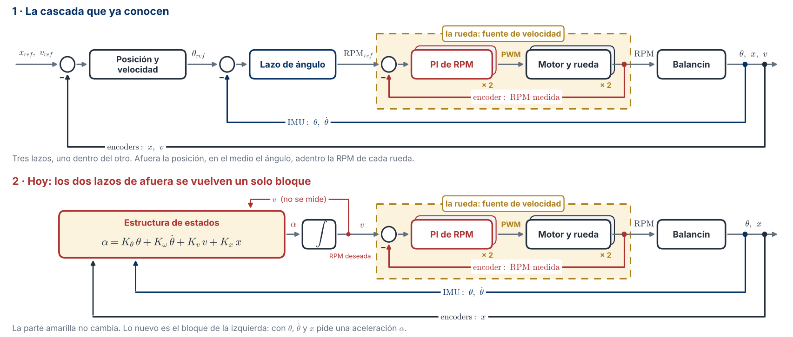
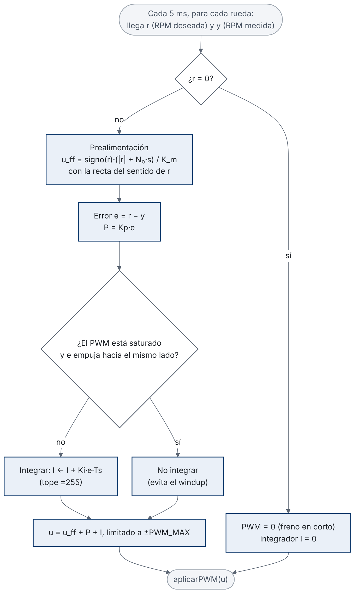
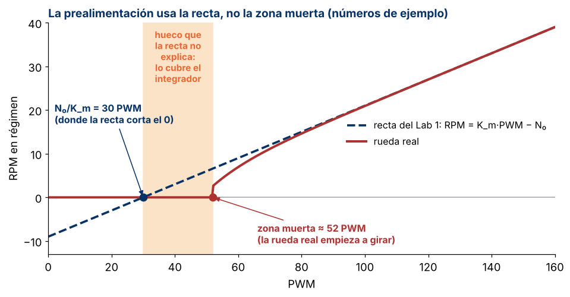

# Guía de laboratorio · Lazo de RPM desde el modelo (versión 2)

**Control Inteligente II (168418) · Ingeniería Mecatrónica · Universidad de Pamplona**\
**Ing. Jeisson Martínez Flórez · Semestre 2026-2**

---

## 1. Datos generales

| Campo | Valor |
|---|---|
| Actividad | Laboratorio · Lazo de RPM de cada rueda (parte A del Taller 2) |
| Unidad | Modelado del balancín y diseño de los lazos de control |
| Sesión | 10B · viernes 6 de noviembre de 2026 · 14:00 a 16:00 |
| Modalidad | Grupal (equipo del proyecto) |
| Herramientas | Sketch `lazo_rpm/` de este repositorio (PlatformIO o Arduino IDE) y el notebook `notebook/taller2_diseno.ipynb` |
| Entra con | `resultados/parametros_motor_G<n>.json` del Lab 1 y el `config.h` del Lab 1 |
| Entrega | Con el Taller 2, antes de la clase del miércoles 11 de noviembre |

---

## 2. ¿Para qué nos sirve este lazo?

En el Lab 1 cada grupo sacó el modelo de sus dos motores. Ahora ese modelo se usa para diseñar el lazo de RPM, que es el lazo de adentro de la cascada. En el esquema es la parte amarilla:



Este lazo hace que cada rueda llegue a la RPM que se le pide en unos 30 ms, y que el integrador corrija lo que el modelo no tiene en cuenta: la carga y la batería. Así la rueda se comporta como una **fuente de velocidad**: se le pide una RPM y la cumple. Con eso, el lazo de equilibrio ya no manda PWM sino aceleración de rueda, y trabaja sobre una planta con unidades físicas. Esa planta es la parte B del Taller 2.

Hoy el lazo se diseña con las fórmulas y se verifica en el robot. Si la medida se parece a lo que predice el modelo, se puede confiar en el modelo para lo que sigue.

**Cada rueda tiene su propio lazo, con su propio encoder.** No se usa una rueda como seguidora de la otra.

Si un canal B está dañado, ese encoder cuenta con un solo canal (x2, es decir, dos flancos por pulso) y no puede saber hacia dónde gira la rueda. Entonces el sentido de las cuentas se toma del signo del PWM. El sketch solo cambia ese sentido cuando la rueda está casi detenida, pero cerca del cruce por cero (ensayos B4 y B5) la medida de esa rueda es menos confiable. La solución definitiva es reparar el canal B.

---

## 3. El lazo

### 3.1 Nombres

En el Lab 1 la recta del motor era RPM ≈ K·PWM − B. Desde aquí se escribe

$$RPM \approx K_m\,PWM - N_0$$

$K_m$ es la K del Lab 1 y $N_0$ es la B del Lab 1. Se cambian de nombre porque B también es una constante del modelo del balancín ($B = M_b\,\ell$) y K es el vector de ganancias del lazo de equilibrio. El JSON no cambia.

Los cuatro parámetros del modelo de cada rueda, todos del Lab 1:

| Parámetro | Qué es | Unidad |
|---|---|---|
| $K_m$ | Ganancia del motor: cuántas RPM sube la rueda por cada unidad de PWM | RPM/PWM |
| $N_0$ | Corte de la recta: con $N_0/K_m$ de PWM, la recta da 0 RPM | RPM |
| $\tau$ | Constante de tiempo del motor: lo que tarda la rueda en llegar al 63 % de su RPM final ante un escalón de PWM | s |
| $L$ | Retardo puro: el tiempo entre el cambio de PWM y el primer movimiento de la rueda | s |

Con ellos, el motor se modela como un sistema de primer orden con retardo:

$$
\frac{RPM(s)}{PWM(s)} = \frac{K_m\,e^{-Ls}}{\tau s + 1}
$$

### 3.2 Las partes

El lazo se calcula una vez por **ciclo**, es decir, en cada pasada del programa de control: leer el encoder, calcular y mandar el PWM. El ciclo se repite cada $T_s = 5$ ms. La RPM se mide con las cuentas de los últimos **10 ms** (dos ciclos). Con menos tiempo, una cuenta de más o de menos cambiaría mucho la RPM medida: con unas 2500 cuentas por vuelta, la resolución es de 2,4 RPM con 10 ms y de 4,8 RPM con 5 ms.

El PWM que se manda a cada rueda tiene tres partes:

$$u = u_{ff} + K_p\,e + I, \qquad e = r - y$$

$r$ es la RPM deseada, $y$ la RPM medida, $e$ el error, $u_{ff}$ la prealimentación, $K_p\,e$ la parte proporcional e $I$ la integral. Cada parte se explica en la tabla:

| Parte | Qué hace | Por qué |
|---|---|---|
| Prealimentación | $u_{ff} = \text{signo}(r)\,(\lvert r\rvert + N_0\,s)/K_m$, con la recta del sentido de la consigna | Sale de despejar el PWM de la recta: $PWM = (RPM + N_0)/K_m$. Pone de una vez el PWM que, según el modelo, da la RPM pedida. El PI solo corrige la diferencia. $\text{signo}(r)$ vale +1 o −1 según el sentido pedido |
| Compensación de la zona muerta | Es el término $N_0/K_m$. Se multiplica por $s = \min(1, \lvert r\rvert / 1\ \text{RPM})$, que sube de 0 a 1 mientras $\lvert r\rvert$ va de 0 a 1 RPM | Es el PWM donde la recta corta el eje. Con $s$, el término aparece de forma gradual y el PWM no salta cuando la consigna cruza el cero |
| P | $K_p\,e$ | Reacción inmediata al error |
| I | $I \leftarrow I + K_i\,e\,T_s$, con tope de ±255 | Elimina el error en régimen: batería, temperatura, carga |
| Integración condicional | Si el mando está saturado (en ±255) y el error empuja hacia el mismo lado, no se integra | Evita el *windup*: con el PWM en el tope, el integrador seguiría creciendo sin cambiar nada, y al salir del tope produciría un sobrepico grande |
| Consigna 0 | PWM 0 con freno en corto (las dos entradas del driver en el mismo nivel) e integrador en cero | Cerca de 0 la rueda no gira de forma sostenida. Es mejor frenar que oscilar |
| Criterio de K | **Por sentido**: con consigna positiva se usan K_m y N₀ de adelante, y con negativa los de atrás | En el equilibrio la rueda cambia de sentido todo el tiempo. El criterio promediado queda para comparar |
| Modelo de referencia (opcional) | El error se calcula contra la consigna pasada por un filtro de primer orden con constante de tiempo τ: la respuesta que se espera del motor | Durante la subida, el error es pequeño, el PI deja de empujar de más y baja el sobrepico |

Así queda en el código, en la función `pasoLazo()`, que se llama una vez por ciclo para cada rueda:

```cpp
static float pasoLazo(Rueda &w, float r, float y, float dt)
{
  w.y = y;
  if (r == 0)
  {
    reiniciarLazo(w); // consigna 0: freno en corto, sin integral que empuje
    return 0;
  }
  // Modelo de referencia (opcional): la respuesta que se espera del motor a la prealimentación
  if (refTauMs > 0)
    w.refF += (r - w.refF) * (1.0f - expf(-dt / (refTauMs * 1e-3f)));
  else
    w.refF = r;
  const float e = w.refF - y;
  const int i = (r > 0) ? 0 : 1;
  const Recta rc = rectaDe(w, r > 0 ? +1 : -1);
  // Prealimentación: inversa de la recta. El término N0/K_m es la compensación de la zona muerta;
  // crece desde 0 hasta |r| = R_SUAVE_RPM para que una consigna que cruza 0 no dé golpes.
  const float s = fminf(1.0f, fabsf(r) / R_SUAVE_RPM);
  w.uFF = conFF ? signo(r) * (fabsf(r) + rc.N0 * s) / rc.Km : 0.0f;
  w.uP = w.kp[i] * e;
  // Integración condicional: no integrar si el mando ya está saturado en el sentido del error
  const float candidato = constrain(w.integ + w.ki[i] * e * dt, -I_MAX_PWM, I_MAX_PWM);
  const float crudo = w.uFF + w.uP + candidato;
  if (!((crudo > PWM_MAX && e > 0) || (crudo < -PWM_MAX && e < 0)))
    w.integ = candidato;
  w.u = constrain(w.uFF + w.uP + w.integ, -PWM_MAX, PWM_MAX);
  return w.u;
}
```

El mismo paso, como diagrama de flujo:



### 3.3 El diseño del PI

El PI tiene la forma

$$
C(s) = K_p\left(1 + \frac{1}{T_i\,s}\right), \qquad K_i = \frac{K_p}{T_i}
$$

y se diseña por **cancelación de polo** (método SIMC de Skogestad):

$$T_i = \tau, \qquad K_p = \frac{\tau}{K_m(\lambda + L_{total})}, \qquad K_i = \frac{K_p}{\tau}, \qquad L_{total} = L + \frac{T_s}{2} + \frac{T_v}{2}$$

| Paso | Qué pasa |
|---|---|
| $T_i = \tau$ | El cero del PI queda en $s = -1/\tau$, justo encima del polo del motor, y lo cancela. Lo que queda en el lazo es un integrador con retardo |
| $K_p$ | Se escoge para que el lazo cerrado responda como un sistema de primer orden con constante de tiempo $\lambda$, más el retardo |
| $\lambda$ | La constante de tiempo que **ustedes** le piden al lazo cerrado. Más pequeña: más rápido, pero más sobrepico y más ruido en el PWM. Se empieza con **λ = 50 ms** |
| $L_{total}$ | Todos los retardos que ve el lazo: el del motor ($L$), medio periodo de muestreo ($T_s/2$) y media ventana de medición ($T_v/2$, con $T_v = 10$ ms). Con $T_s = 5$ ms son unos 10 ms |

Sin prealimentación, el lazo cerrado es de primer orden con constante de tiempo $\lambda$. Con prealimentación, la subida la pone casi toda el motor, porque el PWM correcto llega de una vez, y el PI corrige lo que falta. Por eso el escalón sale más rápido que $\lambda$, pero con sobrepico.

**¿Por qué la prealimentación usa $N_0/K_m$ y no la zona muerta que midieron?** $N_0/K_m$ es el PWM donde la recta, extendida hacia abajo, llega a 0 RPM. La rueda real se detiene antes, porque por debajo de la zona muerta no gira de forma sostenida:



Entre $N_0/K_m$ y la zona muerta queda un hueco que la recta no explica, y ese hueco lo cubre el integrador. Si se compensara la zona muerta completa, el mando saltaría de +zona muerta a −zona muerta cada vez que la consigna cruza el cero, y el motor vibraría. Ese es un error que a mí ya me pasó en el robot.

---

## 4. Materiales

| Elemento | Detalle |
|---|---|
| Robot del grupo | Con la batería cargada, sobre el soporte, **las dos ruedas en el aire** |
| Cable USB | Al puerto UART/COM de la placa |
| Multímetro | Para medir la batería |
| Computador | VS Code con PlatformIO (o Arduino IDE) y Python con Jupyter (VS Code o Google Colab) |
| Archivos del Lab 1 | `parametros_motor_G<n>.json` y `config.h` |

---

## 5. Procedimiento

### Parte A · Diseño y preparación (15 min)

| Paso | Qué hacer | Qué deben ver | Si sale mal |
|---|---|---|---|
| A1 | Actualicen este repositorio (`git pull` o *Download ZIP*) | Las carpetas `lazo_rpm/` y `datos/ejemplo_sintetico_lazo/` | — |
| A2 | Si su JSON no dice `"version": 2`, vuelvan a ejecutar `ajuste_motor.ipynb` con sus datos del Lab 1 | `"version": 2` en el JSON | — |
| A3 | Copien **su** `config.h` del Lab 1 encima de `lazo_rpm/src/config.h`, tal cual | — | Si lo editan a mano, repitan la prueba de sentido del Lab 1 |
| A4 | En `taller2_diseno.ipynb`, celda 0, cambien `GRUPO` y `RUTA_JSON`. Ejecuten hasta la sección A.2 | El semáforo del JSON, la tabla de Kp y Ki, y el archivo `lazo_rpm/src/lazo_config.h` escrito | Si hay un FALTA, completen el Lab 1. Si hay un REVISAR, sepan explicarlo |
| A5 | Abran la carpeta `lazo_rpm` en VS Code como proyecto de PlatformIO. Compilen y carguen | El mensaje de arranque con el modelo de cada rueda y sus Kp y Ki | Si un encoder está en un pin de arranque (GPIO 0, 3, 45 o 46), desconéctelo mientras carga |
| A6 | Comparen los Kp y Ki del monitor con la tabla del notebook | Iguales en las dos ruedas y en los dos sentidos | Si no coinciden, el `lazo_config.h` no es el de su JSON |
| A7 | Midan la batería y anótenla: `b 7.9` (con su valor) | `Batería: 7.90 V` | — |

**Arduino IDE:** creen una carpeta `lazo_rpm`, copien ahí `config.h`, `lazo_config.h` y `main.cpp`, y cambien el nombre de `main.cpp` a `lazo_rpm.ino`.

### Parte B · Escalones de consigna en el robot (20 min)

Robot en el soporte, ruedas en el aire. Cada escalón dura 2,2 s: 500 ms en la base, 1000 ms en el escalón y 700 ms de regreso a la base. **Enter detiene los motores en cualquier momento.**

| Paso | Comando | Para qué | Qué mirar en el resultado rápido |
|---|---|---|---|
| B1 | `r A 30 10` | El escalón base, con las dos ruedas | Error en régimen, subida 10–90 % y sobrepico |
| B2 | `r A -30 -10` | Lo mismo hacia atrás | Que sea parecido a B1 |
| B3 | `r A 10` | Arranque desde parado | Si la rueda arranca de una vez o se queda detenida un rato |
| B4 | `r A -10 10` | Cruce por cero con el criterio por sentido | Cómo pasa la rueda por el cero |
| B5 | `k p`, luego `r A -10 10` y `r A -30 -10`. Al final `k s` | Los mismos ensayos con el criterio promediado (`k p`: promediado; `k s`: por sentido) | Si el error en la subida cambia en algún sentido |
| B6 | `l 30`, luego `r A 30 10`. Al final `l 50` | Un λ más rápido (`l` cambia λ, en ms) | Si gana rapidez o solo sobrepico y ruido |
| B7 | `m` seguido de su τ en ms (por ejemplo `m 20`), luego `r A 30 10`. Al final `m 0` | El modelo de referencia | Cuánto baja el sobrepico y cuánto se demora la subida |
| B8 | `f 0`, luego `r A 30 10`. Al final `f 1` | Solo el PI, sin prealimentación (`f 0` la apaga, `f 1` la enciende) | Cuánto aporta la prealimentación |

Guarden cada bloque entre `INICIO_CSV` y `FIN_CSV` en `datos/G<n>_lazo/`, por ejemplo `G3_lazo_B1.csv`. Otra opción es activar `log2file` en el monitor y guardar toda la sesión en un solo archivo, como en el Lab 1. Lo importante es que no se pierda la línea `#`, porque ahí va el diseño con que se corrió cada ensayo.

### Parte C · Medida frente a modelo (10 min, y se termina fuera de clase)

| Paso | Qué hacer |
|---|---|
| C1 | En la celda 0 del notebook cambien `RUTA_LAZO = Path("../datos/G<n>_lazo")` |
| C2 | Ejecuten la sección A.4. Para cada ensayo, el notebook simula el lazo con el mismo diseño y lo compara con la medida |
| C3 | Revisen la tabla final (subida, sobrepico y error, medidos y del modelo) y la tabla «Qué mirar en la comparación» |

---

## 6. Preguntas de análisis

Están al final del notebook. Las preguntas **4 y 5** son de esta práctica. Respóndanlas con los números de su robot.

---

## 7. Criterios de éxito

- [ ] Los Kp y Ki que imprime el sketch coinciden con los del notebook.
- [ ] Las dos ruedas siguen la consigna en los dos sentidos.
- [ ] Error en régimen menor que 0,5 RPM entre 10 y 50 RPM.
- [ ] Subida 10–90 % menor que 60 ms en el escalón de 10 a 30 RPM.
- [ ] Sobrepico menor que 15 % con el modelo de referencia.
- [ ] En el arranque desde parado (B3), la rueda no se queda detenida más de 100 ms.
- [ ] En el escalón B1, la subida medida y la del modelo difieren en menos de 10 ms.
- [ ] Los CSV de B1 a B8 están en `datos/G<n>_lazo/` con su línea `#`.

---

## 8. Errores frecuentes

| Síntoma | Causa probable | Qué hacer |
|---|---|---|
| Una rueda se dispara al máximo apenas arranca el ensayo | El signo del motor o del encoder quedó mal y el lazo realimenta positivo | Enter. Copien de nuevo el `config.h` del Lab 1 y repitan la prueba de sentido |
| La rueda gira visiblemente más rápido o más lento de lo pedido, o el PWM en régimen es el doble o la mitad del que da el modelo | Las cuentas por vuelta del `config.h` no son las medidas. El lazo sigue la consigna, pero con la escala equivocada | Revisen `CUENTAS_VUELTA_L` y `_R`. Comprueben con una marca en la rueda: `r A 30` son 30 vueltas por minuto, una cada 2 s |
| El motor zumba en régimen | Kp alto para el ruido de la medida: la RPM con ventana de 10 ms cambia en saltos de unas 2,4 RPM, y Kp multiplica esos saltos | Suban λ (`l 70`) y comparen el ruido del PWM |
| La subida medida es más lenta que la del modelo | La batería está más baja que en el Lab 1, así que el $K_m$ real es menor | Midan la batería (`b`). La subida depende de la prealimentación |
| El notebook no encuentra ensayos de lazo | `RUTA_LAZO` no es la carpeta, o se perdió la línea `# ensayo=lazo` | Revisen la ruta y copien el bloque completo |
| El notebook dice «¡Ojo!» | El `lazo_config.h` del robot no es el de su JSON | Vuelvan a generar el archivo (sección A.2) y carguen otra vez |

---

## 9. Recursos de apoyo

- `README.md` de este repositorio: comandos del sketch `lazo_rpm` y problemas comunes.
- `notebook/taller2_diseno.ipynb`: diseño, modelo en lazo cerrado y comparación con la medida.
- `GUIA.md`: el Lab 1, de donde salen $K_m$, $N_0$, $\tau$ y $L$.
- `GUIA_ESTRUCTURA_ESTADOS.md`, sección 4.1: por qué el ciclo es de 5 ms y la ventana de 10 ms.
- S. Skogestad, «Simple analytic rules for model reduction and PID controller tuning», *Journal of Process Control*, vol. 13, n.º 4, pp. 291–309, 2003. Sintonía por cancelación de polo con λ (método SIMC).
- K. J. Åström y T. Hägglund, *Advanced PID Control*, ISA, 2006. Prealimentación, modelo de referencia y *windup*.
